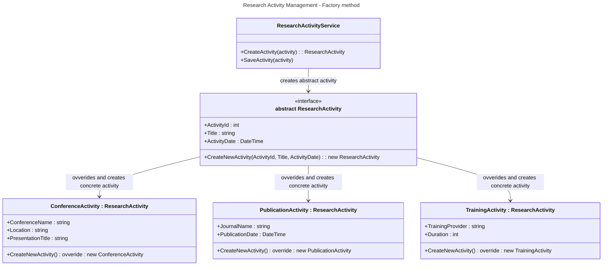
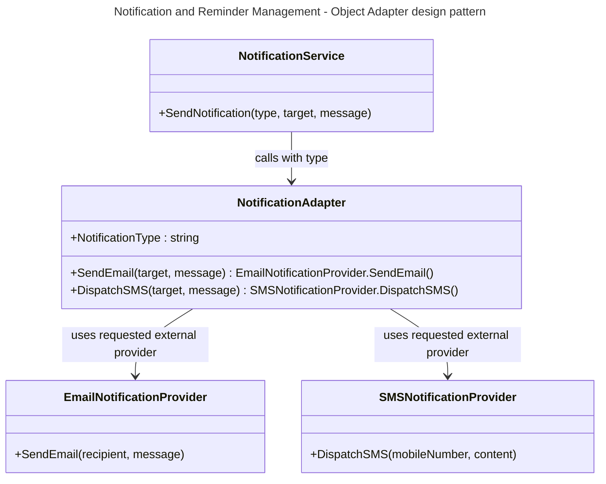
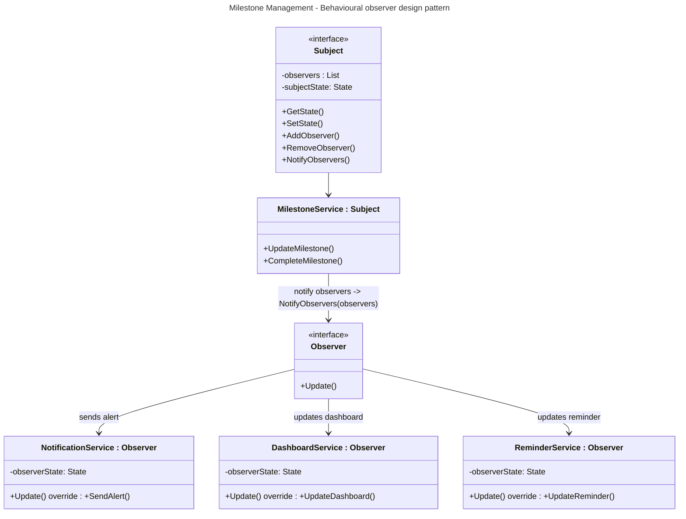

## Creational Design Pattern

**Task:** we have been given the class dagram for research activity management with a service that creates 3 different types of research activities.
Currently, the service is responsible for creating and saving the research activity.

It uses a large if else to switch between all three types, this can be optimised to use the abstract reseach activity type because as the number of activity type increases, the service has to loop through all the options when creating/saving.

the responsibility of creating/saving can be shifted to a factory method that defines an interface for creating objects but lets subclasses decide which object to instantiate.

the service can call the factory method, or become the factory which produces an abstract activity.
concrete activities then ovveride the abstract parent

# Factory Method Pattern

## Structural Design Pattern

**Task:** we have been given different external notification providers and need to unify them on a single interface without changing their individual implementation
this will be done using an adapter design pattern, which is a structural pattern that acts as a bridge between two incompatible interfaces
- class adapter (using inheritance)
- object adapter (using composition)
using the object adapter, it holds an instance of the adaptee object and provides the required interface to the client

## Behavioural Design Pattern

**Task:** simplify the flow of notification whenever a change is made to milestone
Behavioral design patterns focus on how objects communicate and collaborate to manage responsibilities effectively.
They improve flexibility and simplify complex control flows within a system.

Observer Design Pattern is a behavioral pattern that creates a one-to-many relationship between a subject and its observers. When the subject's state changes, all dependent observers are notified and updated automatically, ensuring synchronized communication.

