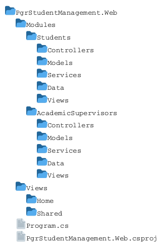
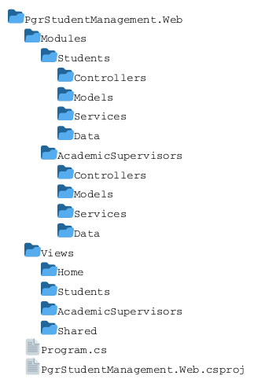
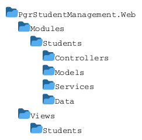
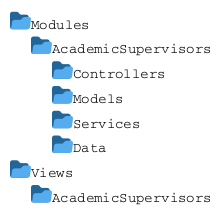
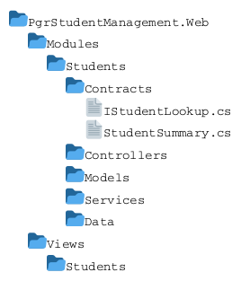

# Week 4 Lab 1: Introduce an Academic Supervisor Module

## Purpose

In Week 3, you organised the Student Management application into presentation, business, and data layers.

In this lab, you will refactor the application into a modular monolith and introduce **Academic Supervisor Management** as a second business module.

The application will remain:

- One ASP.NET Core MVC application
- One running process
- One deployment
- An in-memory implementation

Its internal structure will now be organised around business capabilities:

```text
Student Management
Academic Supervisor Management
```

## Learning Outcomes

By completing this lab, you should be able to:

1. Explain the difference between a layered monolith and a modular monolith.
2. Identify modules from business capabilities.
3. Reorganise existing code without changing its externally observable behaviour.
4. Create a new module with its own presentation, business, data, and domain elements.
5. Represent Academic Supervisors as independent entities.
6. Represent student-supervisor relationships using `SupervisoryAssignment`.
7. Define and respect module ownership.
8. Coordinate a use case that requires information from two modules.
9. Keep use cases, domain models, module boundaries, views, and code consistent.

## Files and Project Required

Before starting, make sure you have:

- The Week 4 starter project containing the completed Week 3 implementation
- `week04-use-cases-student-revised.md`
- `week04-domain-model-student-supervisor.md`
- Your Week 3 use cases, class diagrams, and sequence diagrams
- Any tests or design notes retained from previous weeks

Review the Week 4 use cases and domain model before changing the project.

## What Is a Modular Monolith?

A modular monolith is a single application divided internally into modules that represent business capabilities.

A **business capability** is something the organisation needs to be able to do to achieve its goals. It describes a cohesive area of business responsibility rather than a technical layer, screen, class, or database table.

For example:

- **Student Management** maintains student records, enrolment information, status, and thesis information.
- **Academic Supervisor Management** will maintain supervisor records, eligibility, and supervisory assignments.

A business capability usually has its own terminology, rules, information, lifecycle, and related use cases. In a modular monolith, a module should normally represent one cohesive business capability and own the domain concepts and operations needed to provide it.

Each module should:

- Own its domain concepts.
- Own the operations that manage those concepts.
- Hide internal implementation details from other modules.
- Expose only the operations required by other parts of the application.

A modular monolith is still deployed as one application. The distinction is its internal organisation and dependency discipline.

## Module Structure and Razor View Locations

A suitable Week 4 structure is:



ASP.NET Core MVC normally searches for views under `Views/<Controller>`
and `Views/Shared`.

If you place views inside a module folder, you must either:

1. Configure additional Razor view locations
2. Return an explicit view path from the controller
3. Use ASP.NET Core Areas
4. Keep the Razor views under the application-level `Views` folder while
  placing the controller, service, data, and domain classes inside modules

The structure presented bellow follows approach 4. We are following this approach because it will be explored further later in the module.



Feel free to experiment with any of the other approaches (and document it).
The physical view structure and the paths used by controller actions must remain consistent.

## Module Responsibilities

### Students Module

The Students module owns:

- `Student`
- `Status`
- Student creation and retrieval
- Student enrolment and thesis information
- Student status and thesis submission updates
- Student Razor views
- In-memory student data

Its existing behaviour must continue to satisfy the Week 2 and Week 3 core use cases.

### Academic Supervisors Module

The Academic Supervisors module owns:

- `AcademicSupervisor`
- `SupervisorEmploymentType`
- `SupervisoryRole`
- `SupervisoryAssignment`
- Academic Supervisor creation and retrieval
- Supervisor eligibility information
- Supervisory assignments
- Supervisor and assignment Razor views
- In-memory supervisor and assignment data

### Cross-Module Interaction

Creating a supervisory assignment requires:

- A student owned by the Students module
- An Academic Supervisor owned by the Academic Supervisors module

The Academic Supervisors module may request the minimum student information needed to confirm that a student exists and display an assignment.

It must not access the Students module's in-memory collection directly.

Use an explicit module operation or contract for student lookup. The exact implementation is a design decision that you must document.

# Core Tasks

## Task 1: Preserve and Check the Week 3 Baseline

Before restructuring the project:

1. Build and run the your Week 3 implementation.
2. Exercise `W2-UC01` to `W2-UC05`.
3. Exercise `W3-UC01` to `W3-UC03`.
4. Record any current limitations or incomplete work.
5. Save or commit a working checkpoint.

```bash
git status
git add .
git commit -m "Preserve working Week 3 layered implementation"
```

_Optionally, you can use the provided starter project for this week._

## Task 2: Identify the Module Boundaries

Review the existing classes and assign each one to a business module.

Create a table using these headings:

| Element | Owning Module | Responsibility |
|---|---|---|
| `Student` | Students | Complete from your implementation |
| `StudentController` | Students | Complete from your implementation |
| `StudentService` | Students | Complete from your implementation |
| `StudentStorage` | Students | Complete from your implementation |

Add the new Week 4 concepts and decide which module owns them.

Check that ownership is based on business responsibility rather than only technical type.

## Task 3: Reorganise the Students Module

Move the existing Student Management implementation into a Students module.

A possible structure is:



Update:

- Namespaces
- `using` directives
- View locations or view paths
- Dependency-injection registration
- Razor imports
- Navigation links
- Tests, if present

Do not change the behaviour of the existing Student Management use cases during this refactoring.

After moving the code:

1. Build the application.
2. Run the application.
3. Exercise the eight existing core use cases.
4. Fix structural issues before introducing the new module.

## Task 4: Review the Week 4 Domain Model

Open `week04-domain-model-student-supervisor.md`.

Review:

- `AcademicSupervisor`
- `SupervisorEmploymentType`
- `SupervisoryRole`
- `SupervisoryAssignment`
- The relationships and multiplicities
- Role-specific eligibility
- Current and historical assignments

Record your decisions about:

- Which suggested fields you will include.
- Which fields are mandatory or optional.
- How external supervisors are identified using the supplied `staffNumber` model.
- Whether eligible roles are stored or derived.
- Whether current assignment state is calculated from `endDate`.
- How authorised exceptions are represented.

Update your copy of the domain model to reflect your decisions.

## Task 5: Create the Academic Supervisors Module

Create the Academic Supervisors module structure.

A possible structure is:



The controller, model, service, and data classes are placed inside the
Academic Supervisors module. Razor views remain under the application-level
`Views/AcademicSupervisors` directory so they can be discovered using the
standard ASP.NET Core MVC view-location conventions.

Create the domain types selected from the supplied model:

- `AcademicSupervisor`
- `SupervisorEmploymentType`
- `SupervisoryRole`
- `SupervisoryAssignment`

Keep these types inside the Academic Supervisors module.

## Task 6: Create AcademicSupervisorStorage

Create an in-memory data class owned by the Academic Supervisors module.

It should own separate collections for:

- Academic Supervisors
- Supervisory assignments

Representative fields are:

```csharp
private readonly List<AcademicSupervisor> _academicSupervisors;
private readonly List<SupervisoryAssignment> _supervisoryAssignments;
```

Representative operations may include:

```csharp
public IReadOnlyList<AcademicSupervisor> GetAcademicSupervisors();
public AcademicSupervisor? GetAcademicSupervisor(string staffNumber);
public void AddAcademicSupervisor(AcademicSupervisor supervisor);
public IReadOnlyList<SupervisoryAssignment> GetAssignmentsForStudent(string studentNumber);
public IReadOnlyList<SupervisoryAssignment> GetAssignmentsForSupervisor(string staffNumber);
public void AddSupervisoryAssignment(SupervisoryAssignment assignment);
public void UpdateSupervisoryAssignment(SupervisoryAssignment assignment);
```

These signatures are examples. Choose operations that match your use cases and model.

The storage class must not:

- Select Razor views.
- Return redirects.
- Apply supervisory business rules.
- Access the Students module's collection directly.

## Task 7: Create AcademicSupervisorService

Create a service owned by the Academic Supervisors module.

The service should coordinate:

- Academic Supervisor creation
- Supervisor retrieval and ordering
- Supervisory-assignment creation
- Supervisory-team retrieval
- Eligibility and assignment business rules

Inject the Academic Supervisor storage dependency through the constructor.

The service may also depend on an explicit Students-module operation or contract for student lookup.

Do not inject `StudentStorage` directly into the Academic Supervisor service. Other modules should not depend on the internal data implementation of the Students module.

## Task 8: Register the Academic Supervisors Module

Register the dependencies required by the Academic Supervisors module in `Program.cs`.
For this lab, you can register the storage and service classes directly:

```csharp
builder.Services.AddSingleton<AcademicSupervisorStorage>();
builder.Services.AddScoped<AcademicSupervisorService>();
```

The singleton `AcademicSupervisorStorage` owns the in-memory Academic Supervisor and supervisory-assignment collections for the lifetime of the running application process.

A scoped `AcademicSupervisorService` instance is created for each web request and receives its dependencies through constructor injection.

Grouping a module’s dependency-injection registrations behind a custom registration method is a common organisational practice in larger applications. It can keep `Program.cs` concise and allow each module to manage the registration of its own internal dependencies.
For this lab, direct registration in `Program.cs` is sufficient. If you want to explore the module-registration approach, see **Appendix: Grouping Module Dependency-Injection Registrations**.

## Task 9: Implement W4-UC01 Create Academic Supervisor

Read `W4-UC01` in the Week 4 use-case document.

Record your decisions about:

- Creation fields
- Mandatory and optional information
- Employment type
- Initial training information
- Eligible roles

Implement the use case through the Academic Supervisors module.

Your implementation should:

- Display an Academic Supervisor creation form.
- Accept the selected supervisor information.
- Avoid creating a supervisor when information selected as mandatory is missing.
- Determine whether the staff number is already in use.
- Add the supervisor through the module's data layer.
- Follow the supplied **Duplicate Staff Number** alternative flow.
- Display the created supervisor's details.
- Include the supervisor in the supervisor list.

## Task 10: Implement W4-UC02 List Academic Supervisors

Read `W4-UC02`.

Record your decisions about:

- Summary fields
- Ordering
- Eligibility information shown in the list
- Missing optional values

Your implementation should:

- Retrieve supervisors through the module's service.
- Obtain supervisor records from the module's storage class.
- Apply the selected ordering in the service.
- Display the selected summary fields.
- Provide a Details option for each supervisor.
- Follow the supplied **No Academic Supervisors Found** alternative flow.
- Leave supervisor information unchanged.

## Task 11: Implement W4-UC03 View Academic Supervisor Details

Read `W4-UC03`.

Record your decisions about:

- Fields shown in the details view
- Fields repeated from the list
- Eligibility information
- Missing optional information

Your implementation should:

- Receive or select a staff number.
- Retrieve the supervisor through the module's service and storage class.
- Display the selected details fields.
- Follow the supplied **Academic Supervisor Not Found** alternative flow.
- Leave supervisor information unchanged.

## Task 12: Define the Student Lookup Contract

`W4-UC04` requires the Academic Supervisors module to confirm that a selected student exists and obtain the limited student information needed to display a supervisory assignment.

The Students module should expose a small public lookup contract. The Academic Supervisors module may depend on that contract, but it must not depend on `StudentStorage`, the private student collection, or other internal implementation classes in the Students module.

### Create the Public Contract

Place the contract and its result type in a public contracts namespace owned by the Students module.

A possible location is:



A possible contract is:

```csharp
namespace PgrStudentManagement.Web.Modules.Students.Contracts;

public interface IStudentLookup
{
    StudentSummary? GetStudentSummary(string studentNumber);
}
```

A possible result type is:

```csharp
namespace PgrStudentManagement.Web.Modules.Students.Contracts;

public record StudentSummary(
    string StudentNumber,
    string DisplayName);
```

These declarations are examples. Choose names and fields that match your implementation and the information required by the supervisory use cases.

The intended module dependency is:

```text
Academic Supervisors Module -> Students Module public contract
```

### Implement the Contract

The Students module must provide the implementation of `IStudentLookup`.

A simple approach is for `StudentService` to implement the contract:

```csharp
public class StudentService : IStudentLookup
{
    private readonly StudentStorage _studentStorage;

    public StudentService(StudentStorage studentStorage)
    {
        _studentStorage = studentStorage;
    }

    public StudentSummary? GetStudentSummary(
        string studentNumber)
    {
        var student = _studentStorage.GetStudent(
            studentNumber);

        if (student is null)
        {
            return null;
        }

        return new StudentSummary(
            student.StudentNumber,
            student.FullName);
    }
}
```

Adapt the mapping to the fields in your `Student` model. Do not expose the complete `Student` entity when the consuming module needs only a student number and display name.

A dedicated lookup class is another valid design if you want to keep the public module contract separate from the main Student service.

### Register the Contract

If `StudentService` implements `IStudentLookup`, register it so both service types resolve to the same scoped instance:

```csharp
builder.Services.AddScoped<StudentService>();

builder.Services.AddScoped<IStudentLookup>(
    provider =>
        provider.GetRequiredService<StudentService>());
```

If you create a dedicated implementation, register the interface and implementation directly:

```csharp
builder.Services.AddScoped<IStudentLookup, StudentLookup>();
```

### Use the Contract

Inject the lookup contract into `AcademicSupervisorService`:

```csharp
public class AcademicSupervisorService
{
    private readonly AcademicSupervisorStorage _supervisorStorage;

    private readonly IStudentLookup _studentLookup;

    public AcademicSupervisorService(
        AcademicSupervisorStorage supervisorStorage,
        IStudentLookup studentLookup)
    {
        _supervisorStorage = supervisorStorage;
        _studentLookup = studentLookup;
    }
}
```

The Academic Supervisors module may depend on:

- `IStudentLookup`
- `StudentSummary`
- Other deliberately exposed Students-module contract types

It must not depend on:

- `StudentStorage`
- The private `List<Student>`
- Student controllers or Razor views
- Internal Students-module implementation classes

### Check the Module Boundary

Document:

1. Which module owns the contract.
2. Which class implements it.
3. Which student fields are exposed through `StudentSummary`.
4. Why those fields are required by the supervisory use cases.
5. How the contract prevents direct access to the Students module’s internal data.
6. How the contract is registered with dependency injection.

## Task 13: Implement W4-UC04 Assign Academic Supervisor to Student

Read `W4-UC04` and the related business rules.

Implement assignment creation through the Academic Supervisors module.

The expected interaction is:

```text
Academic Supervisor view -> AcademicSupervisorsController -> AcademicSupervisorService -> IStudentLookup -> AcademicSupervisorStorage
```

### Represent the Student Reference

The Academic Supervisors module should not store or duplicate the complete `Student` entity.

`SupervisoryAssignment` should retain the student identifier required to resolve the student through the Students module contract.

For example:

```csharp
public class SupervisoryAssignment
{
    public string StudentNumber { get; set; }
        = string.Empty;

    public string SupervisorStaffNumber { get; set; }
        = string.Empty;

    public SupervisoryRole Role { get; set; }

    public DateTime StartDate { get; set; }

    public DateTime? EndDate { get; set; }

    public bool ExceptionAuthorised { get; set; }

    public bool Current => EndDate is null;
}
```

Adapt this class to match the decisions recorded in your domain model.

### Implement the Assignment Flow

Your implementation should:

1. Receive or select a student number.
2. Confirm the student through `IStudentLookup`.
3. Obtain the selected Academic Supervisor through `AcademicSupervisorStorage`.
4. Retrieve the student’s current supervisory assignments.
5. Allow selection of a supervisory role.
6. Accept an assignment start date.
7. Determine whether the supervisor is eligible for the selected role.
8. Apply the relevant employment, role, duplicate-assignment, and supervisor-number rules.
9. Create a `SupervisoryAssignment`.
10. Add the assignment through `AcademicSupervisorStorage`.
11. Return an explicit outcome to the controller.
12. Display the updated supervisory team.

Follow the supplied **Assignment Already Exists** alternative flow when the same current student, Academic Supervisor, and role combination already exists.

The controller should present the result but must not reproduce the supervisory business rules.

### Apply Immediate Assignment Rules

A supervisory team may be incomplete while individual assignments are being added.

When creating one assignment, enforce rules that apply immediately:

- The selected student exists.
- The selected Academic Supervisor exists.
- The selected supervisor is eligible for the selected role.
- An external supervisor is not assigned as Director of Studies or First Supervisor.
- The same current student, Academic Supervisor, and role combination does not already exist.
- The student does not already have a current supervisor in a role that must be unique.
- A fourth current supervisor is not added without the required authorised exception.

The unique-role check applies to:

- `DirectorOfStudies`
- `FirstSupervisor`

Do not automatically apply the same uniqueness rule to `SecondSupervisor` or `Adviser`.

The duplicate check applies only to current assignments. A historical assignment with an end date does not, by itself, prevent the same supervisor from being assigned again in the same role.

### Build the Team Incrementally

Do not prevent the first assignment merely because the team does not yet contain every role required for a completed supervisory arrangement.

Rules describing a completed supervisory arrangement include:

- The student has an institution-employed Director of Studies.
- The student has an institution-employed First Supervisor.
- The completed arrangement normally contains between two and three supervisors.
- A fourth supervisor has the required authorised exception.

Evaluate these rules using a separate service operation or whenever the application performs an operation that requires a complete supervisory team.

For example:

```csharp
public record SupervisoryTeamAssessment(
    bool IsComplete,
    IReadOnlyList<string> Issues);
```

A possible service operation is:

```csharp
public SupervisoryTeamAssessment EvaluateSupervisoryTeam(
    string studentNumber)
{
    throw new NotImplementedException();
}
```

A separate team-finalisation workflow is not required unless you choose to introduce one.

### Return an Explicit Outcome

`AcademicSupervisorService` should return an outcome that explains whether the assignment was created.

For example:

```csharp
public enum AssignmentOutcome
{
    Created,
    StudentNotFound,
    SupervisorNotFound,
    DuplicateAssignment,
    RoleAlreadyFilled,
    SupervisorNotEligible,
    EmploymentTypeNotPermitted,
    ExceptionRequired
}
```

These outcomes represent possible implementation results. 
If an outcome introduces an observable path not already described by the supplied use case, document it as an additional alternative flow when completing the extension activity.

A possible service operation is:

```csharp
public AssignmentOutcome AssignSupervisor(
    string studentNumber,
    string staffNumber,
    SupervisoryRole role,
    DateTime startDate,
    bool exceptionAuthorised)
{
    throw new NotImplementedException();
}
```

These types and signatures are examples. You may use another result type if it clearly communicates the outcome to the controller.

### Record Your Design Decisions

Decide and document:

- Whether `Adviser` assignments count towards the supervisor-number limit.
- Where an authorised fourth-supervisor exception is recorded.
- Whether eligibility is stored or derived.
- How a current assignment is identified.
- Whether start dates include time or only a calendar date.
- How incomplete and complete supervisory teams are displayed.
- Which service operation evaluates team completeness.

Apply these decisions consistently to the domain model, use cases, service rules, storage operations, views, tests, and diagrams.

### In-Memory Storage Note

The singleton in-memory storage used in this lab is a teaching implementation.

A mutable `List<T>` shared across requests is not a production-ready concurrent data store. Do not treat it as a general thread-safety pattern.

## Task 14: Implement W4-UC05 View Student Supervisory Team

Read `W4-UC05`.

Record your decisions about:

- Fields displayed for each supervisor
- Assignment ordering
- Current and historical grouping
- Representation of the derived current state

Your implementation should:

- Confirm or retrieve the selected student through the module contract.
- Retrieve assignments through `AcademicSupervisorService`.
- Obtain assignment records from `AcademicSupervisorStorage`.
- Resolve the associated supervisor information.
- Distinguish current and historical assignments.
- Display role, start date, end date where applicable, and assignment state.
- Follow the supplied **No Supervisory Assignments Found** alternative flow.
- Leave all records unchanged.

## Task 15: Check Module Encapsulation

Search the project and confirm that:

- Student controllers and views do not access Academic Supervisor storage directly.
- Academic Supervisor controllers and views do not access Student storage directly.
- One module does not modify another module's collection.
- Cross-module access occurs through an explicit operation or contract.
- Domain classes remain in their owning module.
- Dependency direction is visible and intentional.
- Shared code is not used as a place to hide module-specific behaviour.

Create a short dependency table showing each cross-module dependency and its purpose.

## Task 16: Verify the Complete Core Application

Build and run the application.

Verify:

- `W2-UC01` to `W2-UC05`
- `W3-UC01` to `W3-UC03`
- `W4-UC01` to `W4-UC05`

Check that:

- Existing Student Management behaviour still works.
- Supervisor creation, listing, and details work.
- Assignments connect existing students and supervisors.
- Assignment business rules are applied by the Academic Supervisor service.
- Student and supervisor data remain available during the running application process.
- Restarting the process restores the initial in-memory data.
- No controller directly accesses a storage collection.

# Extension Tasks

## Extension Task 1: Implement W4-UC06 Update Academic Supervisor Eligibility

Read `W4-UC06`.

Decide:

- Which training information is represented.
- Whether eligible roles are stored or derived.
- How employment type affects eligibility.
- How incomplete eligibility information is presented.

Keep eligibility decisions in the Academic Supervisors module service.

## Extension Task 2: Implement W4-UC07 End Supervisory Assignment

Read `W4-UC07`.

Your implementation should retain assignment history by recording an end date rather than deleting the assignment.

Consider:

- How `/current` is derived.
- Whether an end reason is recorded.
- How ending a required role affects the supervisory arrangement.
- Which service applies the rule.

## Extension Task 3: Implement W4-UC08 View Academic Supervisor Assignments

Read `W4-UC08`.

Display current and historical assignments from the Academic Supervisor perspective, including the selected student summary information and supervisory role.

Use the student lookup contract rather than accessing Student storage directly.

## Extension Task 4: Add Module-Level Tests

Create or update tests for:

- Academic Supervisor creation
- Duplicate staff numbers
- Supervisor retrieval and ordering
- Role-specific eligibility
- Duplicate current assignments
- Unique current Director of Studies and First Supervisor roles
- External-supervisor role restrictions
- Authorised fourth-supervisor exceptions
- Current and historical assignment display
- Cross-module student lookup
- Preservation of existing Student Management behaviour

## Extension Task 5: Identify Additional Alternative Flows

After implementing the supplied scenarios, identify additional alternative flows.

For each new flow:

1. Add it to the use-case description.
2. State the observable response and postconditions.
3. Identify the module responsible for the decision.
4. Add or update tests.
5. Keep all artefacts consistent.

# Reflection Questions

1. What makes the application a modular monolith rather than two separate applications?
2. Which domain concepts belong to the Students module?
3. Which domain concepts belong to the Academic Supervisors module?
4. Why does `SupervisoryAssignment` belong to the Academic Supervisors module?
5. Why should the Academic Supervisors module not access `StudentStorage` directly?
6. What student information must cross the module boundary?
7. Where are supervisory business rules applied?
8. How is role-specific eligibility represented?
9. How are current and historical assignments distinguished?
10. Which changes reorganised existing code, and which added new behaviour?
11. What would make the module boundary difficult to maintain?
12. Which parts of the design may need to change when data persistence is introduced?

# Completion Checklist

## Core

- [ ] I preserved a working Week 3 baseline.
- [ ] I identified the Students and Academic Supervisors module boundaries.
- [ ] I moved the existing Student Management implementation into the Students module.
- [ ] All eight existing core use cases still work.
- [ ] I reviewed and revised the supplied Week 4 domain model.
- [ ] I created the Academic Supervisors module structure.
- [ ] I created the Academic Supervisor and assignment domain types.
- [ ] I created module-owned in-memory storage.
- [ ] I created the Academic Supervisor service and controller.
- [ ] I registered the module dependencies.
- [ ] I implemented `W4-UC01` to `W4-UC05`.
- [ ] I implemented an explicit student lookup contract.
- [ ] The Academic Supervisors module does not access Student storage directly.
- [ ] I applied the supervisory-assignment business rules.
- [ ] The use cases, domain model, modules, views, and code are consistent.

## Extensions

- [ ] I implemented `W4-UC06`, if attempted.
- [ ] I implemented `W4-UC07`, if attempted.
- [ ] I implemented `W4-UC08`, if attempted.
- [ ] I added module-level tests, if attempted.
- [ ] I documented additional alternative flows, if attempted.

# Keeping the Project for Later Weeks

There is no submission for this Week 4 project.

Keep the complete modular-monolith project, use cases, revised domain model, tests, and design notes in your files or source-control repository. The class and sequence diagrams will be created in Lab 2.

Before finishing:

1. Build and run the complete application.
2. Exercise all core use cases.
3. Save or commit the working project.
4. Record incomplete extension work or known issues.
5. Confirm that the project can be restored and opened later.

```bash
git status
git add .
git commit -m "Complete Week 4 modular monolith iteration"
```

# Appendix: Grouping Module Dependency-Injection Registrations

You may register the Academic Supervisors module’s dependencies directly in `Program.cs`:

```csharp
builder.Services.AddSingleton<AcademicSupervisorStorage>();
builder.Services.AddScoped<AcademicSupervisorService>();
```

Alternatively, you can group these registrations in a module-registration method:

```csharp
builder.Services.AddAcademicSupervisorsModule();
```

`AddAcademicSupervisorsModule()` is not supplied by ASP.NET Core. It is a custom extension method that you create.

This approach keeps related registrations together and prevents `Program.cs` from needing to know about every class used internally by the module.

## Create the Registration Method

Create a file inside the Academic Supervisors module:

```text
Modules/AcademicSupervisors/AcademicSupervisorsModule.cs
```

Add:

```csharp
using Microsoft.Extensions.DependencyInjection;
using PgrStudentManagement.Web.Modules.AcademicSupervisors.Data;
using PgrStudentManagement.Web.Modules.AcademicSupervisors.Services;

namespace PgrStudentManagement.Web.Modules.AcademicSupervisors;

public static class AcademicSupervisorsModule
{
    public static IServiceCollection AddAcademicSupervisorsModule(
        this IServiceCollection services)
    {
        services.AddSingleton<AcademicSupervisorStorage>();
        services.AddScoped<AcademicSupervisorService>();

        return services;
    }
}
```

The `this IServiceCollection services` parameter makes this an extension method. Returning `IServiceCollection` allows it to be combined with other registration methods.

## Use the Registration Method

Import the module namespace in `Program.cs`:

```csharp
using PgrStudentManagement.Web.Modules.AcademicSupervisors;
```

Register the module:

```csharp
var builder = WebApplication.CreateBuilder(args);

builder.Services.AddControllersWithViews();
builder.Services.AddAcademicSupervisorsModule();

var app = builder.Build();
```

Registration methods can also be chained:

```csharp
builder.Services
    .AddStudentsModule()
    .AddAcademicSupervisorsModule();
```

## Keep Registration Ownership Clear

Each module should register the dependencies it owns.

The Academic Supervisors module should register:

```text
AcademicSupervisorStorage
AcademicSupervisorService
```

The Students module should register:

```text
StudentStorage
StudentService
IStudentLookup
```

The Academic Supervisors module may consume `IStudentLookup`, but it should not register or access `StudentStorage`.

If `StudentService` implements `IStudentLookup`, the Students module can register the contract as follows:

```csharp
services.AddScoped<StudentService>();

services.AddScoped<IStudentLookup>(
    provider =>
        provider.GetRequiredService<StudentService>());
```

This allows `StudentService` and `IStudentLookup` to resolve to the same scoped instance during a web request.

## Check Your Registration

Whichever approach you use, confirm that:

- Each dependency is registered once.
- Each module registers the classes it owns.
- `AcademicSupervisorStorage` is registered as a singleton.
- `AcademicSupervisorService` is registered as scoped.
- `AcademicSupervisorService` receives dependencies through constructor injection.
- `IStudentLookup` is registered by the Students module.
- The Academic Supervisors module does not access `StudentStorage`.
- The application starts without dependency-resolution errors.

Using a module-registration method is optional. Direct registration in `Program.cs` is sufficient for this lab.

## What to Search For

To investigate this approach, search for:

- `ASP.NET Core IServiceCollection extension method`
- `ASP.NET Core register groups of services`
- `C# extension method this IServiceCollection`
- `ASP.NET Core dependency injection service lifetimes`

Useful Microsoft documentation topics include:

- **Register groups of services with extension methods**
- **Dependency injection in ASP.NET Core**
- **Service registration in .NET**
- **Dependency-injection service lifetimes**

Prefer examples that use the built-in ASP.NET Core dependency-injection container and extension methods on `IServiceCollection`. Avoid introducing automatic assembly scanning or additional dependency-injection frameworks unless you understand why they are required.
