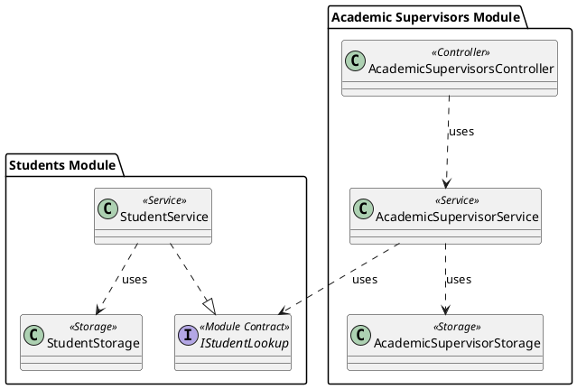

# Week 4 Lab 2: Reverse-Engineer the Modular Monolith

## Purpose

In Week 4 Lab 1, you reorganised the application as a modular monolith and introduced the Academic Supervisors module.

In this lab, you will reverse-engineer the completed implementation into UML models. You will create:

- A class diagram that captures the domain model.
- A separate class diagram that captures the rest of the implementation.
- Sequence diagrams for the five new Week 4 core use cases.

Your diagrams must describe the code you actually implemented.

## Files and Project Required

Before starting, make sure you have:

- Your completed Week 4 Lab 1 project
- `week04-lab1-instructions-student-final.md`
- `week04-use-cases-student-revised.md`
- `week04-domain-model-student-supervisor.md`
- Your module-boundary and cross-module dependency tables
- Your revised domain model
- Any tests and design notes you created

For the extension task, you will also need the initial system description, requirements document, user-story backlog, and detailed user stories.

## Learning Outcomes

By completing this lab, you should be able to:

- Reverse-engineer domain concepts and relationships from source code.
- Separate a domain-model diagram from an implementation-structure diagram.
- Represent module ownership and module boundaries in UML.
- Represent controllers, services, storage classes, contracts, and views.
- Create sequence diagrams from implemented use-case behaviour.
- Check consistency between use cases, models, diagrams, and code.
- Identify potential modules from requirements and business capabilities.

## Core Tasks

### Task 1: Identify the Implemented Modules

Review the completed project and identify its modules. The implementation should contain at least:

- Students module
- Academic Supervisors module

For each module, record:

- The business capability it represents
- The domain concepts it owns
- Its controllers, services, storage classes, and in-memory collections
- The Razor views used to present its behaviour
- The public contracts it exposes
- The contracts from other modules on which it depends

Update the module-boundary table created in Lab 1 if necessary.

### Task 2: Identify the Domain-Model Elements

Inspect the domain classes and enumerations in both modules.

Your domain-model diagram may include:

#### Students Module

- `Student`
- `Status`

#### Academic Supervisors Module

- `AcademicSupervisor`
- `SupervisorEmploymentType`
- `SupervisoryRole`
- `SupervisoryAssignment`

Include only fields, derived attributes, relationships, and enumerations that exist in your implementation. Do not include controllers, services, storage classes, views, dependency-injection registration, or module contracts in this diagram.

### Task 3: Create the Domain-Model Class Diagram

Create a PlantUML class diagram that captures the implemented domain model. Group concepts by their owning module.

Show, where present:

- Domain classes and enumerations
- Attributes and types
- Derived attributes
- Associations and multiplicities
- Dependencies on enumeration types
- Information held by `SupervisoryAssignment`

Use the actual names and types from your code.

The diagram should make it possible to answer:

- How are students and Academic Supervisors identified?
- How can each participate in several supervisory assignments?
- Where is the supervisory role stored?
- How are current and historical assignments distinguished?
- How are role-specific eligibility and authorised exceptions represented?

If `SupervisoryAssignment` stores identifiers rather than complete object references, show those attributes. You may add a conceptual association if it is clearly labelled and explained. Do not imply that the Academic Supervisors module owns the complete `Student` entity.

### Task 4: Check the Domain Diagram

Verify that every represented class, attribute, enumeration value, derived value, and relationship agrees with the source code and use cases. Confirm that domain types are placed in their owning module and that `SupervisoryAssignment` contains information belonging to the relationship.

## Implementation Class Diagram

### Task 5: Identify the Implementation Elements

Identify the non-domain elements in both modules:

- Controllers
- Services
- Storage classes
- Public module contracts
- Contract summaries and service outcomes
- Razor views
- In-memory collections
- Constructor dependencies
- Module registration methods, if introduced

Exclude generated files, framework internals, NuGet classes, static libraries, build output, and files unrelated to the implemented use cases.

### Task 6: Create the Implementation Class Diagram

Create a separate PlantUML class diagram for the implementation structure. Group elements by module and responsibility.

Show, where present:

- `StudentController`, `StudentService`, and `StudentStorage`
- `AcademicSupervisorsController`, `AcademicSupervisorService`, and `AcademicSupervisorStorage`
- `IStudentLookup` and `StudentSummary`
- Service result or outcome types
- Razor views
- In-memory collection fields
- Public operations and controller actions
- Constructor and cross-module dependencies

Use stereotypes consistently where useful.

### Task 7: Represent Module Boundaries and Contracts

The implementation diagram should make this dependency visible:

```text
Academic Supervisors Module -> Students Module public contract
```

It should not show:

```text
AcademicSupervisorService -> StudentStorage
```

Show which class implements `IStudentLookup` and which class consumes it. The following example assumes that `StudentService` implements the contract.

#### PlantUML Source

```text
@startuml Week4_Module_Boundaries

package "Students Module" {
    interface IStudentLookup <<Module Contract>>
    class StudentService <<Service>>
    class StudentStorage <<Storage>>
}

package "Academic Supervisors Module" {
    class AcademicSupervisorsController <<Controller>>
    class AcademicSupervisorService <<Service>>
    class AcademicSupervisorStorage <<Storage>>
}

StudentService ..|> IStudentLookup
StudentService ..> StudentStorage : uses
AcademicSupervisorsController ..> AcademicSupervisorService : uses
AcademicSupervisorService ..> IStudentLookup : uses
AcademicSupervisorService ..> AcademicSupervisorStorage : uses

@enduml
```

#### Diagram



If a dedicated adapter implements `IStudentLookup`, show that class instead. Also show the Students controller-to-service dependency and ownership of each module's in-memory collections. Represent only dependencies that exist in your source code.

### Task 8: Add Razor Views

Add the Razor views used by the implemented core use cases. Use their exact filenames and folders.

Distinguish views for Student Management, supervisor creation, listing and details, assignment creation, and supervisory-team display. Do not show views directly accessing storage or collections.

### Task 9: Check the Implementation Diagram

Verify that:

- Every represented class, interface, operation, parameter, and result type exists.
- Constructor dependencies match the code.
- Each collection appears in the storage class that owns it.
- Cross-module interaction occurs through the public contract.
- Controllers do not access storage directly.
- Services do not select views.
- Storage classes do not make presentation decisions.
- View filenames and controller actions match the project.
- The implementation diagram agrees with the domain-model diagram.

## Sequence Diagrams for the New Core Use Cases

Create one sequence diagram for each new Week 4 core use case:

- `W4-UC01`: Create Academic Supervisor
- `W4-UC02`: List Academic Supervisors
- `W4-UC03`: View Academic Supervisor Details
- `W4-UC04`: Assign Academic Supervisor to Student
- `W4-UC05`: View Student Supervisory Team

Each diagram should represent the implemented main scenario and supplied alternative flow.

### Task 10: Create the W4-UC01 Sequence Diagram

Show the PgRT, creation view, controller, service, storage, and in-memory supervisor collection. Include form display, submission, staff-number lookup, creation, storage, success response, and **Duplicate Staff Number**.

### Task 11: Create the W4-UC02 Sequence Diagram

Show the PgRT requesting the list, controller delegation, storage retrieval, service ordering, summary display, and **No Academic Supervisors Found**. The operation must not modify supervisor data.

### Task 12: Create the W4-UC03 Sequence Diagram

Show receipt of the staff number, controller delegation, service and storage lookup, details display, and **Academic Supervisor Not Found**. The operation must not modify supervisor data.

### Task 13: Create the W4-UC04 Sequence Diagram

Show:

- Student confirmation through `IStudentLookup`
- Supervisor and current-assignment retrieval
- Role-specific eligibility and employment decisions
- Unique-role and duplicate-current-assignment decisions
- Supervisor-number and exception decision
- Creation and storage of `SupervisoryAssignment`
- Updated supervisory-team response
- **Assignment Already Exists**

Do not show `AcademicSupervisorService` calling `StudentStorage` directly. Represent explicit service outcomes if your implementation uses them.

### Task 14: Create the W4-UC05 Sequence Diagram

Show student confirmation through the public contract, assignment retrieval, resolution of supervisor information, distinction between current and historical assignments, team display, and **No Supervisory Assignments Found**. The operation must not modify any record.

### Task 15: Check the Sequence Diagrams

Verify that every participant and message corresponds to the code or another model, parameters and outcomes match the implementation, module and layer boundaries are respected, and each supplied alternative is shown. Do not invent classes or operations for convenience.

### Task 16: Compare the Three Model Types

Compare the domain-model class diagram, implementation class diagram, and sequence diagrams.

Record examples of:

- A domain relationship represented by identifiers in code
- A business rule represented as service behaviour
- A module contract represented as an interface
- A storage collection represented as an implementation detail
- A view or controller present only in the implementation model
- A sequence message corresponding to a class operation

Explain why the two class diagrams have different purposes.

## Extension Task: Identify and Model a New Module

Return to the initial system description, requirements document, user-story backlog, and detailed user stories.

### Extension Step 1: Identify Candidate Modules

Identify cohesive business capabilities that could become modules. Do not choose a capability solely because it has a screen or table. Look for its own terminology, rules, information, lifecycle, related use cases, and institutional responsibility.

Create a candidate-module table:

| Candidate Module | Related Requirements or Stories | Main Concepts | Main Responsibilities |
|---|---|---|---|
| Complete from your analysis | Complete from the requirements | Complete from the requirements | Complete from the requirements |

### Extension Step 2: Evaluate the Candidates

For each candidate, consider its related stories, rules, owned concepts, interactions with existing modules, information crossing boundaries, cohesion, and whether it is substantial enough to justify a module.

### Extension Step 3: Select One Module

State the selected module's name, purpose, supporting requirements and stories, actors, responsibilities, owned concepts, and likely dependencies. Do not implement it.

### Extension Step 4: Start the Domain-Model Class Diagram

Create an initial PlantUML domain-model class diagram showing identifiable entities, value concepts, enumerations, attributes, associations, multiplicities, lifecycle information, and rule notes.

Do not begin with controllers, services, storage, database tables, or views. Mark uncertainty with notes rather than inventing requirements.

### Extension Step 5: Identify Module Relationships

Describe likely interactions with the Students module, Academic Supervisors module, and other candidates. Identify the minimum information that may cross each boundary without designing the complete implementation contract.

## Reflection Questions

- Why are the domain-model and implementation class diagrams separate?
- Which module owns `SupervisoryAssignment`?
- How is the student relationship represented without duplicating `Student`?
- Which business rules appear as service interactions?
- Does any diagram reveal direct access to another module's storage?
- Which sequence contains the most cross-module interaction?
- Which requirements suggest further business modules?

## Completion Checklist

### Core

- [ ] I identified the implemented modules and responsibilities.
- [ ] I created and checked a domain-model class diagram.
- [ ] The domain diagram excludes implementation infrastructure.
- [ ] I created and checked a separate implementation class diagram.
- [ ] The implementation diagram shows module boundaries, contracts, and collection ownership.
- [ ] The Academic Supervisors module does not depend directly on `StudentStorage`.
- [ ] I created sequence diagrams for `W4-UC01` to `W4-UC05`.
- [ ] Each sequence includes its supplied alternative flow.
- [ ] Sequence messages correspond to implemented operations.
- [ ] The diagrams respect module and layer boundaries.
- [ ] The use cases, models, diagrams, and source code are consistent.

### Extension

- [ ] I reviewed the initial requirements artefacts.
- [ ] I identified and evaluated candidate business modules.
- [ ] I selected one module for further modelling.
- [ ] I recorded its purpose, requirements, concepts, and dependencies.
- [ ] I created an initial domain-model class diagram.
- [ ] I marked uncertain requirements as notes or questions.

## Keeping the Models for Later Weeks

There is no submission for this lab.

Keep the completed Week 4 project, revised domain model, two class diagrams, five sequence diagrams, module tables, candidate-module analysis, extension model, tests, and design notes for later weeks.
