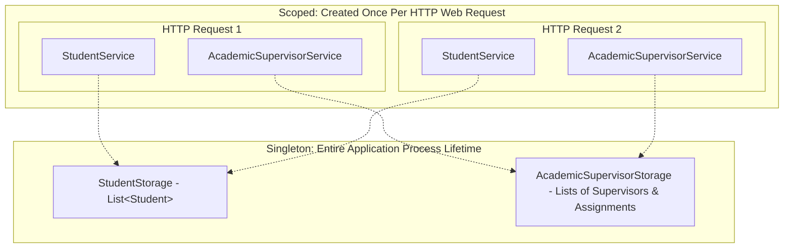

# Dependency Injection Guide: Modular Monolith Service Registrations & Contracts

## 1. Overview of Dependency Injection in ASP.NET Core

**Dependency Injection (DI)** is a software design pattern implementing **Inversion of Control (IoC)**. In ASP.NET Core, services and data stores are registered into a centralized container (`IServiceCollection` in `Program.cs`) and injected automatically into constructors that declare dependencies.

In our **Modular Monolith** architecture, DI serves two critical roles:
1. **Managing Lifetimes**: Controlling how in-memory data persists across web requests versus how services are created per request.
2. **Enforcing Module Boundaries**: Exposing public contract interfaces (`IStudentLookup`) across module boundaries while hiding internal implementation classes (`StudentStorage`, `StudentService`).

---

## 2. Service Lifetimes in This Application

ASP.NET Core supports three lifetime scopes. We use two in this application:



### 1. `Singleton` (`AddSingleton<T>`)
* **Lifetime**: A single instance is instantiated once and lives for the entire running lifespan of the application process.
* **Usage**:
  ```csharp
  builder.Services.AddSingleton<StudentStorage>();
  builder.Services.AddSingleton<AcademicSupervisorStorage>();
  ```
* **Rationale**: Because our application currently uses in-memory collections (`List<Student>`, `List<AcademicSupervisor>`, `List<SupervisoryAssignment>`), singleton lifetime ensures data is preserved between different HTTP requests and page navigations.

### 2. `Scoped` (`AddScoped<T>`)
* **Lifetime**: A new instance is created once per HTTP request and disposed of automatically when the request completes.
* **Usage**:
  ```csharp
  builder.Services.AddScoped<StudentService>();
  builder.Services.AddScoped<AcademicSupervisorService>();
  ```
* **Rationale**: Service classes coordinate business logic, perform validations, and orchestrate storage calls for a single HTTP transaction. Creating them per request avoids state contamination across concurrent users.

---

## 3. Cross-Module Contracts: Two Architectural Approaches

When the **Academic Supervisors Module** needs to confirm that a student exists (`W4-UC04`), it must not depend on `StudentStorage` directly. Instead, it relies on the public interface:

```csharp
namespace PgrStudentManagement.Web.Modules.Students.Contracts;

public interface IStudentLookup
{
    StudentSummary? GetStudentSummary(string studentNumber);
}
```

There are two valid ways to implement and register this contract in ASP.NET Core:

---

### Approach 1: Factory Delegate with Direct Service Implementation (Current Implementation)

In this approach, `StudentService` implements `IStudentLookup` directly.

#### Implementation
```csharp
namespace PgrStudentManagement.Web.Modules.Students.Services;

public class StudentService : IStudentLookup
{
    private readonly StudentStorage _studentStorage;

    public StudentService(StudentStorage studentStorage)
    {
        _studentStorage = studentStorage;
    }

    public StudentSummary? GetStudentSummary(string studentNumber)
    {
        var student = _studentStorage.GetStudent(studentNumber);
        return student is null ? null : new StudentSummary(student.StudentNumber, student.FullName);
    }

    // ... other Student management operations ...
}
```

#### DI Registration in `Program.cs`
```csharp
// Register StudentService as scoped
builder.Services.AddScoped<StudentService>();

// Forward IStudentLookup resolution to the same StudentService instance
builder.Services.AddScoped<IStudentLookup>(provider =>
    provider.GetRequiredService<StudentService>());
```

#### Why Use `provider.GetRequiredService<StudentService>()`?
> [!IMPORTANT]
> If you wrote:
> ```csharp
> // ⚠️ CAUTION: Problematic dual registration
> builder.Services.AddScoped<StudentService>();
> builder.Services.AddScoped<IStudentLookup, StudentService>();
> ```
> ASP.NET Core would register two separate service descriptors. If a single HTTP request required both `StudentService` (e.g. in a controller) and `IStudentLookup` (e.g. in another service), the DI container would instantiate **two distinct instances** of `StudentService`.
>
> By using the **factory delegate** `provider => provider.GetRequiredService<StudentService>()`, the DI container resolves `IStudentLookup` to the **exact same instance** of `StudentService` already created for that HTTP request.
>
>`provider => ...` is a factory lambda expression. The container passes in an `IServiceProvider` (represented by the `provider` variable), which gives you manual access to the DI container.
>
> `provider.GetRequiredService<StudentService>()`  looks up the already-registered `StudentService` instance within the current scope. If `StudentService` hasn't been registered yet, the application will immediately throw a clear runtime exception rather than failing silently.


---

### Approach 2: Dedicated Adapter / Implementation Class (`StudentLookup`)

In this alternative approach, a separate, dedicated class is created specifically to satisfy the public contract.

#### 1. Implementation (`StudentLookup.cs`)
```csharp
namespace PgrStudentManagement.Web.Modules.Students.Contracts;

public class StudentLookup : IStudentLookup
{
    private readonly StudentStorage _studentStorage;

    public StudentLookup(StudentStorage studentStorage)
    {
        _studentStorage = studentStorage;
    }

    public StudentSummary? GetStudentSummary(string studentNumber)
    {
        var student = _studentStorage.GetStudent(studentNumber);
        if (student is null)
        {
            return null;
        }

        return new StudentSummary(
            student.StudentNumber,
            student.FullName);
    }
}
```

#### 2. DI Registration in `Program.cs`
Because `StudentLookup` is a distinct class dedicated solely to `IStudentLookup`, the registration is straightforward:

```csharp
// Students Module
builder.Services.AddSingleton<StudentStorage>();
builder.Services.AddScoped<StudentService>();
builder.Services.AddScoped<IStudentLookup, StudentLookup>();

// Academic Supervisors Module
builder.Services.AddSingleton<AcademicSupervisorStorage>();
builder.Services.AddScoped<AcademicSupervisorService>();
```

---

## 4. Comparison of the Two Approaches

| Metric | Approach 1: `StudentService` Implements Interface | Approach 2: Dedicated `StudentLookup` Class |
|---|---|---|
| **Class Count** | Fewer files (re-uses `StudentService`). | Adds a dedicated `StudentLookup.cs` class. |
| **Registration Complexity** | Requires factory delegate `provider => provider.GetRequiredService<StudentService>()`. | Standard 1-to-1 registration: `AddScoped<IStudentLookup, StudentLookup>()`. |
| **Separation of Concerns (SoC)** | `StudentService` holds both internal student management logic and external contract mappings. | High: `StudentService` focuses on student use cases; `StudentLookup` acts as a pure public facade/adapter. |
| **Interface Segregation** | If many contracts are exposed, `StudentService` risks becoming a "god class". | Clean: Each public contract can have a dedicated implementation adapter. |
| **Instance Reuse** | Shares the scoped instance of `StudentService`. | Creates a lightweight separate scoped instance of `StudentLookup`. |

---

## 5. Encapsulating Registrations with Extension Methods (Appendix Pattern)

To keep `Program.cs` clean and give each module control over its own dependency registrations, you can group registrations into custom extension methods on `IServiceCollection`:

### Students Module Extension (`Modules/Students/StudentsModule.cs`)
```csharp
namespace PgrStudentManagement.Web.Modules.Students;

public static class StudentsModule
{
    public static IServiceCollection AddStudentsModule(this IServiceCollection services)
    {
        services.AddSingleton<StudentStorage>();
        services.AddScoped<StudentService>();
        services.AddScoped<IStudentLookup>(sp => sp.GetRequiredService<StudentService>());
        // Or for Approach 2:
        // services.AddScoped<IStudentLookup, StudentLookup>();

        return services;
    }
}
```

### Academic Supervisors Module Extension (`Modules/AcademicSupervisors/AcademicSupervisorsModule.cs`)
```csharp
namespace PgrStudentManagement.Web.Modules.AcademicSupervisors;

public static class AcademicSupervisorsModule
{
    public static IServiceCollection AddAcademicSupervisorsModule(this IServiceCollection services)
    {
        services.AddSingleton<AcademicSupervisorStorage>();
        services.AddScoped<AcademicSupervisorService>();

        return services;
    }
}
```

### Clean `Program.cs`
```csharp
var builder = WebApplication.CreateBuilder(args);

builder.Services.AddControllersWithViews();

// Register business modules cleanly
builder.Services
    .AddStudentsModule()
    .AddAcademicSupervisorsModule();

var app = builder.Build();
```

---

## 6. Summary Checklist
- [x] Storage classes holding in-memory mutable data are registered as `Singleton`.
- [x] Business services are registered as `Scoped` (instantiated per web request).
- [x] Cross-module dependencies are restricted to public contract interfaces (`IStudentLookup`).
- [x] Direct dependencies from `AcademicSupervisors` onto `StudentStorage` are completely avoided.
