# Week 5 Starter Project: UML Class Diagram

This diagram reverse-engineers the verified structure of the attached Week 5 starter project. 
It shows the two production modules, application shell, seeders, public Student lookup contract and Razor-view groups. 

## PlantUML

```plantuml
@startuml Week05_Starter_Implementation_Class_Diagram

title Week 5 Starter Project - Implementation Class Diagram

skinparam classAttributeIconSize 0
skinparam shadowing false
skinparam packageStyle rectangle
hide empty methods

package "PgrStudentManagement.Web" {

    package "Application Shell" {
        class HomeController <<Controller>> {
            +Index() : IActionResult
        }

        class ErrorViewModel <<View Model>> {
            +RequestId : string?
        }

        class Program <<Composition Root>>
note bottom of Program
The composition root registers module services
and runs StudentDataSeeder before
AcademicSupervisorDataSeeder.
end note

    }

    package "Students Module" {

        package "Contracts" {
            interface IStudentLookup <<Module Contract>> {
                +GetStudentSummary(studentNumber : string) : StudentSummary?
            }

            class StudentSummary <<Contract DTO>> {
                +StudentNumber : string
                +DisplayName : string
            }
        }

        package "Domain" {
            class Student <<Entity>> {
                +StudentNumber : string
                +FirstName : string
                +LastName : string
                +Course : string?
                +ModeOfStudy : string?
                +StartDate : DateTime?
                +Status : Status
                +ThesisTitle : string?
                +OriginalExpectedSubmissionDate : DateTime?
                +ExpectedSubmissionDate : DateTime?
                +ActualSubmissionDate : DateTime?
                +FullName : string <<derived>>
            }

            enum Status {
                Researching
                WritingUp
                Submitted
                Suspended
                Corrections
                Continuation
                Completed
            }
        }

        package "Data" {
            class StudentStorage <<Storage>> {
                -_students : List<Student>
                +GetStudents() : IReadOnlyList<Student>
                +GetStudent(studentNumber : string) : Student?
                +StudentNumberExists(studentNumber : string) : bool
                +AddStudent(student : Student) : void
                +UpdateStudent(student : Student) : void
            }

            class StudentDataSeeder <<Seeder>> {
                -_studentStorage : StudentStorage
                +Seed() : void
            }
        }

        package "Services" {
            class StudentService <<Service>> {
                -_studentStorage : StudentStorage
                +GetStudentSummary(studentNumber : string) : StudentSummary?
            }

            class OperationResult <<Result>> {
                +Succeeded : bool
                +ErrorMessage : string?
            }

            class "OperationResult<T>" as OperationResultOfT <<Result>> {
                +Succeeded : bool
                +Value : T?
                +ErrorMessage : string?
            }
        }

        package "Presentation" {
            class StudentsController <<Controller>> {
                -_studentService : StudentService
            }

            class "Views/Students/*.cshtml" as StudentViews <<Razor Views>>


note bottom of StudentViews
The source bundle contains Create, Details,
EditExpectedSubmissionDate, EditStatus,
EnrolmentDetails, Index, RecordSubmission,
StudentNotFound, and ThesisDetails views.
end note

        }
    }

    package "Academic Supervisors Module" {

        package "Domain and View Models" {
            class AcademicSupervisor <<Entity>> {
                +StaffNumber : string
                +FirstName : string
                +LastName : string
                +EmailAddress : string
                +EmploymentType : SupervisorEmploymentType
                +TrainingCompleted : bool
                +EligibleRoles : Set<SupervisoryRole>
            }

            class SupervisoryAssignment <<Entity>> {
                +StudentNumber : string
                +SupervisorStaffNumber : string
                +Role : SupervisoryRole
                +StartDate : DateTime
                +EndDate : DateTime?
                +ExceptionAuthorised : bool
                +Current : bool <<derived>>
            }
note right of SupervisoryAssignment
The code stores StudentNumber and
SupervisorStaffNumber identifiers.
The associations show the intended
domain relationships.
end note
            enum SupervisorEmploymentType {
                InstitutionEmployed
                External
            }

            enum SupervisoryRole {
                DirectorOfStudies
                FirstSupervisor
                SecondSupervisor
                Adviser
            }

            class CreateAcademicSupervisorViewModel <<View Model>> {
                +StaffNumber : string
                +FirstName : string
                +LastName : string
                +EmailAddress : string
                +EmploymentType : SupervisorEmploymentType?
                +TrainingCompleted : bool
                +EligibleRoles : List<SupervisoryRole>
            }

            class AssignmentRequest <<Request Model>> {
                +StudentNumber : string
                +StaffNumber : string
                +Role : SupervisoryRole
                +StartDate : DateTime
                +ExceptionAuthorised : bool
            }

            class AssignmentFormResult <<Result Model>> {
                +Student : StudentSummary?
                +Supervisors : IReadOnlyList<AcademicSupervisor>
                +AvailableRoles : IReadOnlyList<SupervisoryRole>
            }

            class SupervisoryAssignmentViewModel <<View Model>> {
                +SupervisorStaffNumber : string
                +SupervisorName : string
                +EmploymentType : SupervisorEmploymentType
                +Role : SupervisoryRole
                +StartDate : DateTime
                +EndDate : DateTime?
                +Current : bool <<derived>>
            }

            class SupervisoryTeamResult <<Result Model>> {
                +Student : StudentSummary?
                +CurrentAssignments : IReadOnlyList<SupervisoryAssignmentViewModel>
                +HistoricalAssignments : IReadOnlyList<SupervisoryAssignmentViewModel>
            }
        }

        package "Data" {
            class AcademicSupervisorStorage <<Storage>> {
                -_academicSupervisors : List<AcademicSupervisor>
                -_supervisoryAssignments : List<SupervisoryAssignment>
                +GetAcademicSupervisors() : IReadOnlyList<AcademicSupervisor>
                +GetAcademicSupervisor(staffNumber : string) : AcademicSupervisor?
                +AddAcademicSupervisor(supervisor : AcademicSupervisor) : void
                +GetAssignmentsForStudent(studentNumber : string) : IReadOnlyList<SupervisoryAssignment>
                +GetAssignmentsForSupervisor(staffNumber : string) : IReadOnlyList<SupervisoryAssignment>
                +AddSupervisoryAssignment(assignment : SupervisoryAssignment) : void
                +UpdateSupervisoryAssignment(assignment : SupervisoryAssignment) : void
            }

            class AcademicSupervisorDataSeeder <<Seeder>> {
                -_storage : AcademicSupervisorStorage
                -_studentLookup : IStudentLookup
                +Seed() : void
            }

note right of AcademicSupervisorDataSeeder
Students must be seeded first.
The seeder validates Student references
through IStudentLookup before creating
supervisory assignments.
end note

        }

        package "Services" {
            class AcademicSupervisorService <<Service>> {
                -_storage : AcademicSupervisorStorage
                -_studentLookup : IStudentLookup
                +PrepareAssignment(studentNumber : string) : AssignmentFormResult
                +AssignSupervisor(request : AssignmentRequest) : AssignmentOutcome
                +GetSupervisoryTeam(studentNumber : string) : SupervisoryTeamResult
            }

            enum AssignmentOutcome {
                Created
                StudentNotFound
                SupervisorNotFound
                DuplicateAssignment
                RoleAlreadyFilled
                SupervisorNotEligible
                EmploymentTypeNotPermitted
                ExceptionRequired
            }

            enum SupervisorOutcome {
                Created
                DuplicateStaffNumber
                MissingRequiredInformation
            }
        }

        package "Presentation" {
            class AcademicSupervisorsController <<Controller>> {
                -_academicSupervisorService : AcademicSupervisorService
            }

            class "Views/AcademicSupervisors/*.cshtml" as AcademicSupervisorViews <<Razor Views>>
note bottom of AcademicSupervisorViews
The source bundle contains Assign, Create,
Details, Index, Notfound, and Team views.
end note
        }
    }
}

' Students module
Student --> Status : uses
StudentService ..|> IStudentLookup
StudentService --> StudentStorage : uses
StudentService ..> StudentSummary : creates
StudentStorage "1" o-- "0..*" Student : stores
StudentDataSeeder --> StudentStorage : seeds
StudentsController --> StudentService : uses
StudentsController ..> StudentViews : returns
StudentViews ..> Student : displays or edits
OperationResultOfT --|> OperationResult : conceptual generic variant

' Academic Supervisors module
AcademicSupervisor --> SupervisorEmploymentType : uses
AcademicSupervisor --> SupervisoryRole : eligible for
SupervisoryAssignment --> SupervisoryRole : uses
AcademicSupervisor "1" -- "0..*" SupervisoryAssignment : referenced by staff number
Student "1" -- "0..*" SupervisoryAssignment : conceptual relationship
AcademicSupervisorStorage "1" o-- "0..*" AcademicSupervisor : stores
AcademicSupervisorStorage "1" o-- "0..*" SupervisoryAssignment : stores
AcademicSupervisorDataSeeder --> AcademicSupervisorStorage : seeds
AcademicSupervisorDataSeeder --> IStudentLookup : validates students
AcademicSupervisorService --> AcademicSupervisorStorage : uses
AcademicSupervisorService --> IStudentLookup : uses
AcademicSupervisorService ..> AssignmentRequest : accepts
AcademicSupervisorService ..> AssignmentFormResult : returns
AcademicSupervisorService ..> SupervisoryTeamResult : returns
AcademicSupervisorService ..> AssignmentOutcome : returns
AcademicSupervisorsController --> AcademicSupervisorService : uses
AcademicSupervisorsController ..> CreateAcademicSupervisorViewModel : receives
AcademicSupervisorsController ..> AcademicSupervisorViews : returns
AssignmentFormResult --> StudentSummary
AssignmentFormResult --> AcademicSupervisor
AssignmentFormResult --> SupervisoryRole
SupervisoryTeamResult --> StudentSummary
SupervisoryTeamResult "1" o-- "0..*" SupervisoryAssignmentViewModel
SupervisoryAssignmentViewModel --> SupervisorEmploymentType
SupervisoryAssignmentViewModel --> SupervisoryRole

' Composition root
Program ..> StudentStorage : registers
Program ..> StudentService : registers
Program ..> IStudentLookup : maps implementation
Program ..> StudentDataSeeder : runs
Program ..> AcademicSupervisorStorage : registers
Program ..> AcademicSupervisorService : registers
Program ..> AcademicSupervisorDataSeeder : runs after students

@enduml
```

## Interpretation Notes

- `StudentService` implements `IStudentLookup`, which is consumed by the Academic Supervisors module.
- `StudentStorage` owns the Student collection, while `AcademicSupervisorStorage` owns supervisor and assignment collections.
- `StudentDataSeeder` and `AcademicSupervisorDataSeeder` are separate from storage, and the Academic Supervisor seeder depends on the Student lookup contract.
- The test project contains seeder, storage, and service tests plus `FakeStudentLookup` and fixture data.
- Razor views are grouped to keep the class diagram readable. Individual view filenames are recorded in diagram notes.
