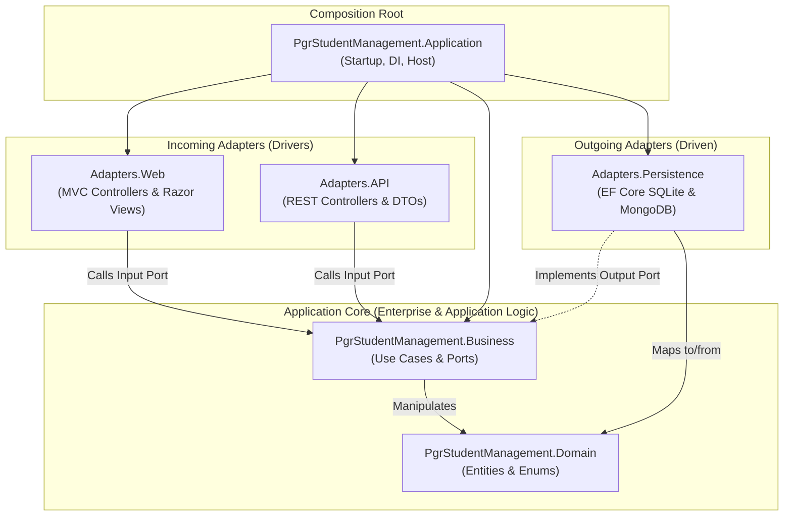

# PGR Student Management - Clean Architecture Sample Application

A reference implementation demonstrating **Clean Architecture** (also known as Hexagonal Architecture or Ports & Adapters) in **.NET 10 / ASP.NET Core**.

This application manages postgraduate research (PGR) students, their academic enrolments, and their research activity logs. It demonstrates how multiple incoming adapters (server-rendered MVC Razor views and RESTful JSON APIs) can drive the same core business use cases, and how business logic remains completely decoupled from database technologies (Entity Framework Core / SQLite and MongoDB).

---

## Architecture Overview

The system strictly adheres to Robert C. Martin's **Dependency Rule**:

> *Source-code dependencies point strictly inward toward Business and Domain.*



---

## Key Clean Architecture Concepts Showcased

### 1. The Dependency Rule & Layer Decoupling
- **`Domain` is the innermost layer:** Contains pure C# business entities (`Student`, `Enrolment`, `ResearchActivity`). It has **zero dependencies** on external libraries, ORMs, BSON serialization, or ASP.NET Core.
- **`Business` encapsulates application logic:** Implements use cases (interactors), owns input ports, and declares output ports. It references **only** `Domain` and has no knowledge of databases, HTTP, or user interfaces.
- **Adapters are plugins:** `Adapters.Web`, `Adapters.API`, and `Adapters.Persistence` depend inward on `Business` and `Domain`. They never reference one another.

### 2. Ports and Adapters Pattern

| Port Category | Interface (Contract) | Port Owner | Implementation (Adapter) | Invocation Flow |
|---|---|---|---|---|
| **Input Port** | `IViewStudentEnrolmentsUseCase` | `Business` | `ViewStudentEnrolmentsUseCase` | MVC / API &rarr; Business |
| **Input Port** | `IRecordResearchActivityUseCase` | `Business` | `RecordResearchActivityUseCase` | MVC / API &rarr; Business |
| **Input Port** | `IViewStudentResearchActivitiesUseCase` | `Business` | `ViewStudentResearchActivitiesUseCase` | MVC / API &rarr; Business |
| **Output Port** | `IEnrolmentGateway` | `Business` | `EfEnrolmentGateway` (`Adapters.Persistence`) | Business &rarr; Persistence |
| **Output Port** | `IResearchActivityGateway` | `Business` | `MongoResearchActivityGateway` (`Adapters.Persistence`) | Business &rarr; Persistence |

> **Why does `Business` own the output ports?**  
> Under the **Dependency Inversion Principle (DIP)**, high-level business rules must not depend on low-level storage details. By defining `IEnrolmentGateway` inside `Business`, the use case defines *what* data it needs, while the persistence adapter implements *how* to query SQLite or MongoDB.

### 3. Strict Model Separation & Mapping
To prevent database schemas or UI requirements from polluting the domain, each boundary maintains its own models:

```text
Database Record (EF / BSON)
         ↕ (Persistence Mapper)
    Domain Entity
         ↕ (Business Interactor)
  Business Input/Output DTO
         ↕ (Web Mapper / API Mapper)
  View Model (MVC) / Response Model (REST)
```

- **Domain Entities:** `Enrolment`, `ResearchActivity`, `Student` (pure business state and invariants).
- **Business DTOs:** `ViewStudentEnrolmentsInput`, `StudentEnrolmentsOutput`, `RecordResearchActivityInput` (transport-agnostic parameters).
- **Persistence Models:** `EnrolmentRecord`, `StudentRecord`, `ResearchActivityDocument` (table columns, foreign keys, BSON IDs).
- **Presentation Models:** `StudentEnrolmentsViewModel`, `RecordResearchActivityViewModel` (display formatting such as `"Not recorded"`, validation attributes).
- **API Models:** `StudentEnrolmentsResponse`, `RecordResearchActivityRequest` (strongly-typed machine contracts).

### 4. Shared Use Cases Across Dual Incoming Adapters
Both the Razor UI and the REST API invoke the **exact same Business interactor**:
- `StudentsController.Enrolments()` (Web) &rarr; `IViewStudentEnrolmentsUseCase.ExecuteAsync()`
- `StudentsApiController.GetEnrolments()` (REST) &rarr; `IViewStudentEnrolmentsUseCase.ExecuteAsync()`

Both adapters guarantee identical business behavior (filtering, earliest-to-latest chronological ordering, empty collection handling) without duplicating business logic.

---

## Solution Structure

```text
PgrStudentManagement.sln
│
├── PgrStudentManagement.Domain/                 # Core domain entities and enumerations
│   ├── Enrolments/
│   ├── ResearchActivities/
│   └── Students/
│
├── PgrStudentManagement.Business/               # Use cases, ports, and boundary DTOs
│   ├── ResearchActivities/
│   │   ├── Gateway/                             # Output port: IResearchActivityGateway
│   │   ├── RecordResearchActivity/              # W5-UC04: Use case & DTOs
│   │   └── ViewStudentResearchActivities/       # W5-UC03: Use case & DTOs
│   └── Students/
│       ├── Gateway/                             # Output port: IEnrolmentGateway
│       └── ViewStudentEnrolments/               # W5-UC01: Use case & DTOs
│
├── PgrStudentManagement.Adapters.Persistence/   # Outgoing data access adapters
│   ├── Relational/                              # EF Core 10 & SQLite implementation
│   │   ├── Configurations/
│   │   ├── Gateway/                             # EfEnrolmentGateway
│   │   ├── Mappers/                             # EnrolmentPersistenceMapper
│   │   └── Models/                              # EnrolmentRecord, StudentRecord
│   └── Documents/                               # MongoDB implementation
│       ├── Gateway/                             # MongoResearchActivityGateway
│       ├── Mappers/                             # ResearchActivityDocumentMapper
│       └── Models/                              # ResearchActivityDocument
│
├── PgrStudentManagement.Adapters.Web/           # Incoming MVC Razor Class Library
│   ├── Controllers/                             # StudentsController, ResearchActivitiesController
│   ├── Mappers/                                 # Web presentation mappers
│   ├── ViewModels/                              # Razor view models
│   └── Views/                                   # Server-rendered Razor views
│
├── PgrStudentManagement.Adapters.API/           # Incoming REST API adapter
│   ├── Controllers/                             # StudentsApiController, ResearchActivitiesApiController
│   ├── Mappers/                                 # API serialization mappers
│   ├── Requests/                                # HTTP request contracts
│   └── Responses/                               # JSON response contracts
│
├── PgrStudentManagement.Application/           # Composition Root & Executable Host
│   ├── Program.cs                               # Dependency Injection wiring & pipeline
│   ├── appsettings.json                         # Configuration
│   └── wwwroot/                                 # Static assets (Bootstrap, CSS, JS)
│
└── PgrStudentManagement.Tests/                  # Comprehensive unit & architecture tests
    ├── Architecture/                            # Reflection tests verifying the Dependency Rule
    ├── Business/                                # Fast use case tests using fake gateways
    ├── Persistence/                             # Data mapper tests
    ├── Web/                                     # Web mapper tests
    ├── API/                                     # API mapper tests
    └── TestDoubles/                             # In-memory test doubles (FakeEnrolmentGateway, etc.)
```

---

## Implemented Use Cases

### 1. `W5-UC01: View Student Enrolments` (Relational / SQLite)
- **Actor:** College Administrator
- **Goal:** View student enrolment history in chronological order.
- **Technology:** Queries relational SQLite database via `EfEnrolmentGateway`.
- **Clean Architecture Features:** Chronological ordering enforced by the use case; missing expected end dates rendered as `"Not recorded"` in MVC while preserved as `null` in the REST API.

### 2. `W5-UC04: Record Research Activity` (Document / MongoDB)
- **Actor:** Postgraduate Researcher / Supervisor
- **Goal:** Log a research milestone, supervision meeting, or reflection.
- **Technology:** Persists unstructured research logs via `MongoResearchActivityGateway` (with built-in resilient in-memory fallback for offline environments).
- **Clean Architecture Features:** Use case generates application identifiers (`activity-{guid}`), assigns creation timestamps, rejects unsupported activity types, and halts persistence calls if validation fails.

### 3. `W5-UC03: View Student Research Activities` (Document / MongoDB)
- **Actor:** Postgraduate Researcher / College Administrator
- **Goal:** Review a student's research activity log in chronological order.
- **Technology:** Retrieved via `MongoResearchActivityGateway`.
- **Clean Architecture Features:** Business interactor owns sorting by `ActivityDate` from earliest to latest.

---

## Getting Started

### Prerequisites
- [.NET 10 SDK](https://dotnet.microsoft.com/download)

### Building the Solution
```bash
dotnet build
```

### Running the Application
Run the single executable host project:
```bash
dotnet run --project PgrStudentManagement.Application
```
The application will launch on `http://localhost:5066`.

### Testing Routes

#### MVC Razor Web Interface
- **Dashboard:** [http://localhost:5066](http://localhost:5066)
- **View Enrolments (S100001):** [http://localhost:5066/Students/Enrolments?studentNumber=S100001](http://localhost:5066/Students/Enrolments?studentNumber=S100001)
- **View Enrolments (Multiple):** [http://localhost:5066/Students/Enrolments?studentNumber=S100002](http://localhost:5066/Students/Enrolments?studentNumber=S100002)
- **View Research Activities:** [http://localhost:5066/ResearchActivities?studentNumber=S100001](http://localhost:5066/ResearchActivities?studentNumber=S100001)
- **Record New Activity Form:** [http://localhost:5066/ResearchActivities/Record?studentNumber=S100001](http://localhost:5066/ResearchActivities/Record?studentNumber=S100001)

#### RESTful JSON API Endpoints
- **Get Enrolments:** `GET /api/students/S100001/enrolments`
- **Get Activities:** `GET /api/students/S100001/research-activities`
- **Record Activity:** `POST /api/students/S100001/research-activities`
  ```json
  {
    "activityType": "ConferenceAttendance",
    "title": "Presented Paper at Software Architecture Conf",
    "activityDate": "2026-05-15T00:00:00Z",
    "tags": ["conference", "ieee"],
    "details": { "Location": "London" }
  }
  ```

---

## Running Automated Tests

All tests run in isolation without requiring active SQLite or MongoDB servers:
```bash
dotnet test
```

### Test Coverage Highlights:
- **Architecture Tests:** [`DomainDependencyTests.cs`](file:///Users/martincooper/Documents/learning%20materials/sad-2026/PgrStudentManagement-week06-Solution/PgrStudentManagement.Tests/Architecture/DomainDependencyTests.cs) inspects compiled assembly references to programmatically verify that `Domain` has no dependencies on EF Core, MongoDB, ASP.NET Core, or outer layers.
- **Business Use Case Tests:** Uses fast in-memory fake gateways ([`FakeEnrolmentGateway.cs`](file:///Users/martincooper/Documents/learning%20materials/sad-2026/PgrStudentManagement-week06-Solution/PgrStudentManagement.Tests/TestDoubles/FakeEnrolmentGateway.cs), [`FakeResearchActivityGateway.cs`](file:///Users/martincooper/Documents/learning%20materials/sad-2026/PgrStudentManagement-week06-Solution/PgrStudentManagement.Tests/TestDoubles/FakeResearchActivityGateway.cs)) to test business validation, identifier generation, and chronological sorting in milliseconds.
- **Mapper Unit Tests:** Verifies bidirectional translation across persistence, web, and API boundaries.

---

## Modular Monolith Deployment (Extension 3)

Although the codebase is split into 6 production assemblies to enforce the Dependency Rule at compile time, it compiles and deploys as a **single, unified executable**:

```bash
dotnet publish PgrStudentManagement.Application --configuration Release
```

Published assemblies in `bin/Release/net10.0/publish/`:
- `PgrStudentManagement.Domain.dll`
- `PgrStudentManagement.Business.dll`
- `PgrStudentManagement.Adapters.Persistence.dll`
- `PgrStudentManagement.Adapters.Web.dll`
- `PgrStudentManagement.Adapters.API.dll`
- `PgrStudentManagement.Application.dll` (Host & entry point)

**Why this matters:**  
Clean Architecture provides modularity and separation of concerns **without** the operational complexity, network latency, or serialization overhead of microservices. At runtime, all layers run in the same process with high-speed in-memory method invocations.

---

## Further Reading
- For in-depth reflection answers to the 8 core lab questions and extension reflections, see [reflections.md](reflections.md).
