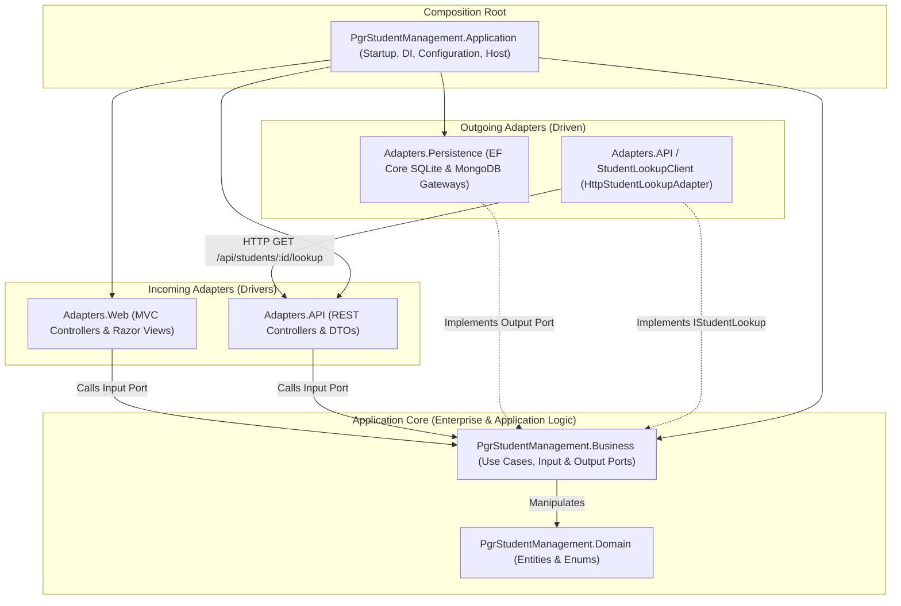

# PGR Student Management - Week 7: From Modules to Services (Clean Architecture)

A reference implementation demonstrating **Clean Architecture** (Ports & Adapters) and **Cross-Module to Service Evolution** in **.NET 10 / ASP.NET Core**.

This solution builds upon the Week 5 and Week 6 reference solutions by:
1. Refactoring the **Academic Supervisors** module into the Clean Architecture project structure (`Domain`, `Business`, `Adapters.Persistence`, `Adapters.API`, `Application`).
2. Exposing Academic Supervisors (`GET` & `POST /api/students/{studentNumber}/academic-supervisors`) and Students Lookup (`GET /api/students/{studentNumber}/lookup`) through REST incoming adapters.
3. Evolving the `IStudentLookup` output port from a direct in-process adapter (`LocalStudentLookupAdapter`) in **Part 1** to an outgoing HTTP client adapter (`HttpStudentLookupAdapter`) in **Part 2** without modifying a single line of Academic Supervisors Business code.

---

## Architecture Overview

The system strictly adheres to Robert C. Martin's **Dependency Rule**:

> *Source-code dependencies point strictly inward toward Business and Domain.*



---

## Ports and Adapters Summary

| Port Category | Interface (Contract) | Port Owner | Implementation (Adapter) | Invocation Flow |
|---|---|---|---|---|
| **Input Port** | `IAssignAcademicSupervisorUseCase` | `Business (AcademicSupervisors)` | `AssignAcademicSupervisorUseCase` | API &rarr; Business |
| **Input Port** | `IViewSupervisoryTeamUseCase` | `Business (AcademicSupervisors)` | `ViewSupervisoryTeamUseCase` | API &rarr; Business |
| **Input Port** | `IGetStudentSummaryUseCase` | `Business (Students)` | `GetStudentSummaryUseCase` | API / Local Adapter &rarr; Business |
| **Input Port** | `IViewStudentEnrolmentsUseCase` | `Business (Students)` | `ViewStudentEnrolmentsUseCase` | MVC / API &rarr; Business |
| **Input Port** | `IRecordResearchActivityUseCase` | `Business (ResearchActivities)` | `RecordResearchActivityUseCase` | MVC / API &rarr; Business |
| **Input Port** | `IViewStudentResearchActivitiesUseCase` | `Business (ResearchActivities)` | `ViewStudentResearchActivitiesUseCase` | MVC / API &rarr; Business |
| **Output Port** | `IStudentLookup` | `Business (AcademicSupervisors)` | `LocalStudentLookupAdapter` (Part 1)<br/>`HttpStudentLookupAdapter` (Part 2) | Business &rarr; Students Lookup |
| **Output Port** | `IAcademicSupervisorGateway` | `Business (AcademicSupervisors)` | `EfAcademicSupervisorGateway` (`Adapters.Persistence`) | Business &rarr; SQLite |
| **Output Port** | `IStudentGateway` | `Business (Students)` | `EfStudentGateway` (`Adapters.Persistence`) | Business &rarr; SQLite |
| **Output Port** | `IEnrolmentGateway` | `Business (Students)` | `EfEnrolmentGateway` (`Adapters.Persistence`) | Business &rarr; SQLite |
| **Output Port** | `IResearchActivityGateway` | `Business (ResearchActivities)` | `MongoResearchActivityGateway` (`Adapters.Persistence`) | Business &rarr; MongoDB |

---

## Solution Structure

```text
PgrStudentManagement.slnx
│
├── PgrStudentManagement.Domain/                 # Pure domain entities and enumerations
│   ├── AcademicSupervisors/                     # AcademicSupervisor, SupervisoryAssignment, SupervisoryRole, SupervisorEmploymentType
│   ├── ResearchActivities/                      # ResearchActivity, ResearchActivityType
│   └── Students/                                # Student, Enrolment, EnrolmentStatus
│
├── PgrStudentManagement.Business/               # Use cases, input/output ports, and boundary DTOs
│   ├── AcademicSupervisors/
│   │   ├── AssignAcademicSupervisor/            # IAssignAcademicSupervisorUseCase, AssignAcademicSupervisorUseCase, AssignmentOutcome
│   │   ├── Gateway/                             # IAcademicSupervisorGateway, IStudentLookup, StudentSummary, LocalStudentLookupAdapter
│   │   └── ViewSupervisoryTeam/                 # IViewSupervisoryTeamUseCase, ViewSupervisoryTeamUseCase
│   ├── ResearchActivities/
│   │   ├── Gateway/                             # IResearchActivityGateway
│   │   ├── RecordResearchActivity/              # W5-UC04
│   │   └── ViewStudentResearchActivities/       # W5-UC03
│   └── Students/
│       ├── Gateway/                             # IStudentGateway, IEnrolmentGateway
│       ├── GetStudentSummary/                   # IGetStudentSummaryUseCase, GetStudentSummaryUseCase
│       └── ViewStudentEnrolments/               # W5-UC01
│
├── PgrStudentManagement.Adapters.Persistence/   # Outgoing data access adapters
│   ├── Relational/                              # EF Core 10 & SQLite implementation
│   │   ├── Gateway/                             # EfAcademicSupervisorGateway, EfStudentGateway, EfEnrolmentGateway
│   │   ├── Mappers/                             # AcademicSupervisorPersistenceMapper, StudentPersistenceMapper, EnrolmentPersistenceMapper
│   │   ├── Migrations/                          # InitialStudentEnrolmentModel, AddAcademicSupervisors
│   │   ├── Models/                              # AcademicSupervisorRecord, AcademicSupervisorEligibleRoleRecord, SupervisoryAssignmentRecord, StudentRecord, EnrolmentRecord
│   │   ├── AcademicSupervisorDataSeeder.cs      # Idempotent asynchronous Academic Supervisor & assignment seeder
│   │   ├── DatabaseSeeder.cs                    # Student & enrolment seeder
│   │   └── StudentManagementDbContext.cs        # Shared relational DbContext
│   └── Documents/                               # MongoDB implementation
│
├── PgrStudentManagement.Adapters.API/           # Incoming REST controllers & Outgoing HTTP client adapter
│   ├── AcademicSupervisors/
│   │   └── StudentLookupClient/                 # HttpStudentLookupAdapter, StudentLookupApiResponse
│   ├── Controllers/                             # AcademicSupervisorsApiController, StudentsApiController, ResearchActivitiesApiController
│   ├── Mappers/                                 # AcademicSupervisorsApiMapper, StudentLookupApiMapper, StudentEnrolmentsApiMapper, ResearchActivityApiMapper
│   ├── Requests/                                # AssignAcademicSupervisorRequest, RecordResearchActivityRequest
│   └── Responses/                               # AssignAcademicSupervisorResponse, SupervisoryTeamResponse, StudentLookupResponse, etc.
│
├── PgrStudentManagement.Adapters.Web/           # Incoming MVC Razor Class Library
│
├── PgrStudentManagement.Application/            # Composition Root & Executable Host
│   ├── Program.cs                               # DI wiring, AddHttpClient<IStudentLookup, HttpStudentLookupAdapter>, migration & seeding
│   ├── appsettings.json                         # Connection strings & Services:Students:BaseUrl
│   └── PgrStudentManagement.http                # Ready-to-run HTTP requests for testing
│
└── PgrStudentManagement.Tests/                  # Automated unit, persistence, adapter & architecture tests
```

---

## Getting Started

### Building and Testing
```bash
dotnet build
dotnet test
```

### Running the Application
```bash
dotnet run --project PgrStudentManagement.Application
```
The application listens on `http://localhost:5066` (configured in `appsettings.json` under `Services:Students:BaseUrl`).

### Testing the Week 7 REST Endpoints

You can use the included [`PgrStudentManagement.http`](PgrStudentManagement.Application/PgrStudentManagement.http) file or `curl`:

#### 1. Students Lookup (`GET /api/students/{studentNumber}/lookup`)
```bash
curl -i http://localhost:5066/api/students/S100002/lookup
```
Returns `200 OK`:
```json
{"studentNumber":"S100002","displayName":"Jane Smith"}
```

```bash
curl -i http://localhost:5066/api/students/UNKNOWN/lookup
```
Returns `404 Not Found`.

#### 2. View Supervisory Team (`GET /api/students/{studentNumber}/academic-supervisors`)
```bash
curl -i http://localhost:5066/api/students/S100001/academic-supervisors
```
Returns `200 OK` with current and historical supervisory assignments.

#### 3. Assign Academic Supervisor (`POST /api/students/{studentNumber}/academic-supervisors`)
```bash
curl -i -X POST http://localhost:5066/api/students/S100001/academic-supervisors \
  -H "Content-Type: application/json" \
  -d '{
    "staffNumber": "AS1004",
    "role": "SecondSupervisor",
    "startDate": "2026-10-01T00:00:00Z",
    "exceptionAuthorised": false
  }'
```
Returns `201 Created`:
```json
{
  "outcome": "Created",
  "message": "Academic Supervisor assigned successfully.",
  "assignment": {
    "studentNumber": "S100001",
    "supervisorStaffNumber": "AS1004",
    "role": "SecondSupervisor",
    "startDate": "2026-10-01T00:00:00",
    "endDate": null,
    "exceptionAuthorised": false
  }
}
```

---

## Sequence Diagrams & Reflections
For the Part 1 (Direct Call) and Part 2 (HTTP Lookup) Mermaid sequence diagrams, comparison tables, and answers to all 10 Week 7 reflection questions, see [reflections.md](reflections.md).
