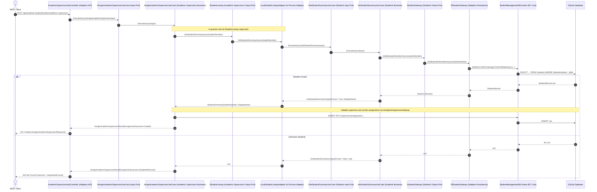
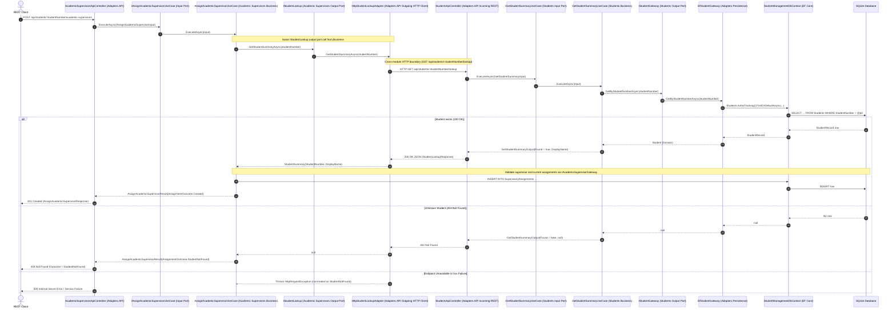

# Week 7 Laboratory 1: From Modules to Services — Architecture Evidence & Reflections

This document provides the sequence diagrams, REST API contracts, runtime evidence, architectural comparison, and answers to the 10 reflection questions from [docs/week07-services-lab1-instructions.md](docs/week07-services-lab1-instructions.md).

---

## 1. Sequence Diagrams: Direct Call vs. Cross-Module HTTP Lookup

Both diagrams use consistent participant and port names to illustrate how replacing the outgoing adapter for `IStudentLookup` changes the runtime interaction from an in-process method call to an HTTP request across the Students REST boundary without altering `AssignAcademicSupervisorUseCase`.

### Part 1 (Task 7): Direct In-Process Student Lookup Sequence Diagram



---

### Part 2 (Task 13): Cross-Module HTTP Student Lookup Sequence Diagram



---

## 2. Comparison of Direct vs. HTTP Interactions (Task 13)

| Aspect | Part 1: Direct Lookup | Part 2: HTTP Lookup |
|---|---|---|
| **Invocation mechanism** | In-process C# method invocation | Outgoing HTTP `GET` request and JSON response |
| **Adapter implementation** | [`LocalStudentLookupAdapter`](PgrStudentManagement.Business/AcademicSupervisors/Gateway/LocalStudentLookupAdapter.cs) | [`HttpStudentLookupAdapter`](PgrStudentManagement.Adapters.API/AcademicSupervisors/StudentLookupClient/HttpStudentLookupAdapter.cs) |
| **Failure modes** | Local database/runtime exceptions only; no network failure | Network connectivity, DNS/socket errors, HTTP timeouts, 5xx status codes, and JSON deserialisation errors |
| **Serialisation** | Zero serialisation; in-memory object references | URL encoding of route parameters and JSON serialisation/deserialisation (`StudentLookupResponse` / `StudentLookupApiResponse`) |
| **Runtime path** | Direct in-process call to `IGetStudentSummaryUseCase` | Crosses the Students REST boundary (`GET /api/students/{studentNumber}/lookup`) |

### What Remains Unchanged Between Part 1 and Part 2
- **The Academic Supervisors use case:** [`AssignAcademicSupervisorUseCase`](PgrStudentManagement.Business/AcademicSupervisors/AssignAcademicSupervisor/AssignAcademicSupervisorUseCase.cs) and [`ViewSupervisoryTeamUseCase`](PgrStudentManagement.Business/AcademicSupervisors/ViewSupervisoryTeam/ViewSupervisoryTeamUseCase.cs) required **zero source-code changes**.
- **The consumer-owned output port:** [`IStudentLookup`](PgrStudentManagement.Business/AcademicSupervisors/Gateway/IStudentLookup.cs) and [`StudentSummary`](PgrStudentManagement.Business/AcademicSupervisors/Gateway/StudentSummary.cs).
- **The Academic Supervisors business rules:** Duplicate assignment checks, unique role constraints (`DirectorOfStudies`, `FirstSupervisor`), role eligibility, institution employment restrictions, and 4th-supervisor exception authorisation.
- **Students ownership of Student information:** Students remains the single source of truth for student identity and summary information.

---

## 3. Retained Laboratory Evidence (Tasks 6, 9, 11, 13)

### A. Dependency Injection Registrations in `PgrStudentManagement.Application/Program.cs`

**Part 1 (Direct in-process adapter registration):**
```csharp
builder.Services.AddScoped<IStudentLookup, LocalStudentLookupAdapter>();
```

**Part 2 (Final HTTP adapter registration using `AddHttpClient` and configuration):**
```csharp
var studentsBaseUrl = builder.Configuration["Services:Students:BaseUrl"]
    ?? throw new InvalidOperationException(
        "The Students service base URL is not configured.");

builder.Services.AddHttpClient<IStudentLookup, HttpStudentLookupAdapter>(client =>
{
    client.BaseAddress = new Uri(studentsBaseUrl);
});
```

**Location of `HttpStudentLookupAdapter`:**
- [`PgrStudentManagement.Adapters.API/AcademicSupervisors/StudentLookupClient/HttpStudentLookupAdapter.cs`](PgrStudentManagement.Adapters.API/AcademicSupervisors/StudentLookupClient/HttpStudentLookupAdapter.cs)
- Transport DTO: [`PgrStudentManagement.Adapters.API/AcademicSupervisors/StudentLookupClient/StudentLookupApiResponse.cs`](PgrStudentManagement.Adapters.API/AcademicSupervisors/StudentLookupClient/StudentLookupApiResponse.cs)

### B. Students Lookup REST Contract & Evidence (Task 9)

- **Route:** `GET /api/students/{studentNumber}/lookup`
- **Known Student Request:** `GET /api/students/S100002/lookup`
  - **Status:** `200 OK`
  - **Response Body:**
    ```json
    {
      "studentNumber": "S100002",
      "displayName": "Jane Smith"
    }
    ```
- **Unknown Student Request:** `GET /api/students/UNKNOWN/lookup`
  - **Status:** `404 Not Found`

### C. Academic Supervisors REST Contract & Evidence (Tasks 5, 6, 12)

- **Route:** `POST /api/students/{studentNumber}/academic-supervisors`
- **Successful Assignment Request (`S100001`):**
  ```http
  POST /api/students/S100001/academic-supervisors
  Content-Type: application/json

  {
    "staffNumber": "AS1004",
    "role": "SecondSupervisor",
    "startDate": "2026-10-01T00:00:00Z",
    "exceptionAuthorised": false
  }
  ```
  - **Status:** `201 Created`
  - **Response Body:**
    ```json
    {
      "outcome": "Created",
      "message": "Academic Supervisor assigned successfully.",
      "assignment": {
        "studentNumber": "S100001",
        "supervisorStaffNumber": "AS1004",
        "role": "SecondSupervisor",
        "startDate": "2026-10-01T00:00:00",
        "endDate": null,
        "exceptionAuthorised": false
      }
    }
    ```
- **Unknown Student Request (`UNKNOWN`):**
  ```http
  POST /api/students/UNKNOWN/academic-supervisors
  Content-Type: application/json

  {
    "staffNumber": "AS1004",
    "role": "SecondSupervisor",
    "startDate": "2026-10-01T00:00:00Z",
    "exceptionAuthorised": false
  }
  ```
  - **Status:** `404 Not Found`
  - **Response Body:**
    ```json
    {
      "outcome": "StudentNotFound",
      "message": "Student not found.",
      "assignment": null
    }
    ```
- **Business Rule Violation Request (Unique Role Already Filled for `S100001`):**
  ```http
  POST /api/students/S100001/academic-supervisors
  Content-Type: application/json

  {
    "staffNumber": "AS1004",
    "role": "FirstSupervisor",
    "startDate": "2026-10-01T00:00:00Z",
    "exceptionAuthorised": false
  }
  ```
  - **Status:** `409 Conflict`
  - **Response Body:**
    ```json
    {
      "outcome": "RoleAlreadyFilled",
      "message": "The selected supervisory role is already filled for this student.",
      "assignment": null
    }
    ```

---

## 4. Week 7 Lab 1 Reflection Questions (Section 7)

### 1. Which classes were added when Academic Supervisors was moved into the Week 6 Clean Architecture?
- **Domain (`PgrStudentManagement.Domain/AcademicSupervisors`):**
  - `AcademicSupervisor`, `SupervisoryAssignment`, `SupervisoryRole`, `SupervisorEmploymentType`.
- **Business (`PgrStudentManagement.Business`):**
  - **Academic Supervisors:** `IAcademicSupervisorGateway`, `IStudentLookup`, `StudentSummary`, `LocalStudentLookupAdapter`, `IAssignAcademicSupervisorUseCase`, `AssignAcademicSupervisorUseCase`, `AssignAcademicSupervisorInput`, `AssignAcademicSupervisorResult`, `SupervisoryAssignmentOutput`, `AssignmentOutcome`, `IViewSupervisoryTeamUseCase`, `ViewSupervisoryTeamUseCase`, `ViewSupervisoryTeamInput`, `SupervisoryTeamOutput`, `SupervisoryTeamMemberOutput`.
  - **Students:** `IStudentGateway`, `IGetStudentSummaryUseCase`, `GetStudentSummaryUseCase`, `GetStudentSummaryInput`, `GetStudentSummaryOutput`.
- **Persistence Adapter (`PgrStudentManagement.Adapters.Persistence/Relational`):**
  - `AcademicSupervisorRecord`, `AcademicSupervisorEligibleRoleRecord`, `SupervisoryAssignmentRecord`, `AcademicSupervisorPersistenceMapper`, `StudentPersistenceMapper`, `EfAcademicSupervisorGateway`, `EfStudentGateway`, `AcademicSupervisorDataSeeder`, and the `AddAcademicSupervisors` migration.
- **API Adapter (`PgrStudentManagement.Adapters.API`):**
  - `AcademicSupervisorsApiController`, `AssignAcademicSupervisorRequest`, `AssignAcademicSupervisorResponse`, `SupervisoryAssignmentResponse`, `SupervisoryTeamResponse`, `SupervisoryTeamMemberResponse`, `AcademicSupervisorsApiMapper`, `StudentLookupResponse`, `StudentLookupApiMapper`, `HttpStudentLookupAdapter`, and `StudentLookupApiResponse`.

### 2. Which parts of the Week 5 Academic Supervisors implementation were reused?
- **Domain terminology and business rules:** The core entities (`AcademicSupervisor`, `SupervisoryAssignment`), enums (`SupervisoryRole`, `SupervisorEmploymentType`), role-eligibility check (`IsEligibleFor`), and the supervisory assignment validation rules from Week 5's `AcademicSupervisorService` (student existence, supervisor existence, duplicate assignment prevention, unique `DirectorOfStudies` / `FirstSupervisor` check, role eligibility, institution-employed requirement for lead roles, and the 4th-supervisor exception rule).
- **Relational schema and seed data:** The table structures (`AcademicSupervisors`, `AcademicSupervisorEligibleRoles` with composite key `(SupervisorStaffNumber, Role)`, and `SupervisoryAssignments` with composite key `(StudentNumber, SupervisorStaffNumber, Role, StartDate)`) and the idempotent seed data in `AcademicSupervisorDataSeeder`.

### 3. Why does Academic Supervisors Business own `IStudentLookup` rather than depend on Students persistence?
- Academic Supervisors Business needs to verify whether a student exists and obtain a minimal summary (`StudentNumber` and `DisplayName`), without knowing *how* or *where* student data is stored.
- If Academic Supervisors Business depended directly on Students persistence (`StudentManagementDbContext` or `EfStudentGateway`), it would violate module encapsulation and the Dependency Inversion Principle, coupling Academic Supervisors to the Students database schema.
- By owning `IStudentLookup` as a consumer-side output port, Academic Supervisors defines the contract it requires, allowing the infrastructure layer to satisfy it via an in-process adapter (`LocalStudentLookupAdapter`) or an HTTP client adapter (`HttpStudentLookupAdapter`) without changing Business code.

### 4. What does the direct-call sequence diagram show that the HTTP API alone does not show?
- Looking only at the external HTTP API (`POST /api/students/{studentNumber}/academic-supervisors`), a caller cannot tell how Academic Supervisors resolves student information internally.
- The direct-call sequence diagram reveals the internal runtime architecture: that `AssignAcademicSupervisorUseCase` invokes `IStudentLookup` via an **in-process call** (`LocalStudentLookupAdapter` -> `IGetStudentSummaryUseCase` -> `EfStudentGateway` -> `StudentManagementDbContext`), executing within a single OS process without network hops or JSON serialisation.

### 5. What changed when the local `IStudentLookup` adapter was replaced by `HttpStudentLookupAdapter`?
- **Provider side (Students):** Added an incoming REST endpoint (`GET /api/students/{studentNumber}/lookup` in `StudentsApiController`), response DTO (`StudentLookupResponse`), and mapper (`StudentLookupApiMapper`) invoking `IGetStudentSummaryUseCase`.
- **Consumer side (Academic Supervisors adapter):** Added `HttpStudentLookupAdapter` and `StudentLookupApiResponse` in `PgrStudentManagement.Adapters.API`, translating `IStudentLookup.GetStudentSummaryAsync` into an asynchronous HTTP `GET` request.
- **Composition Root (`PgrStudentManagement.Application`):** Configured `Services:Students:BaseUrl` in `appsettings.json` and replaced `AddScoped<IStudentLookup, LocalStudentLookupAdapter>()` with `AddHttpClient<IStudentLookup, HttpStudentLookupAdapter>(...)` in `Program.cs`.

### 6. Which parts of Academic Supervisors Business remained unchanged?
- `AssignAcademicSupervisorUseCase` and `ViewSupervisoryTeamUseCase`
- `IAssignAcademicSupervisorUseCase` and `IViewSupervisoryTeamUseCase` (input ports)
- `IStudentLookup`, `StudentSummary`, and `IAcademicSupervisorGateway` (output ports)
- All Business DTOs, `AssignmentOutcome` values, and all supervisory assignment business rules.

### 7. Why is an unknown Student different from an unavailable Students endpoint?
- **Unknown Student (`404 Not Found`):** The Students service is healthy and reachable, and it authoritatively confirms that no student with the given `studentNumber` exists. This is a normal **business outcome** (`AssignmentOutcome.StudentNotFound`), so `HttpStudentLookupAdapter` returns `null`.
- **Unavailable Students endpoint (connection refused, DNS error, timeout, or `5xx` status):** The lookup could not be completed due to an **infrastructure or communication failure**. We do not know whether the student exists or not. Treating an infrastructure outage as "Student not found" would misreport a system failure as a domain fact; therefore `HttpStudentLookupAdapter` throws an `HttpRequestException`.

### 8. Does your final implementation contain one application container or two independently deployable service containers?
- **One application container** (a single deployed web application process hosting both the Academic Supervisors and Students modules, communicating over HTTP loopback).

### 9. What evidence supports that answer?
- There is only a single executable host project (`PgrStudentManagement.Application`) with a single `Program.cs` composition root.
- Both `StudentsApiController` and `AcademicSupervisorsApiController` are loaded into the same ASP.NET Core pipeline (`AddApplicationPart(typeof(StudentsApiController).Assembly)`).
- `Services:Students:BaseUrl` points to `http://localhost:5066`, the same Kestrel server address that receives the incoming Academic Supervisors request.
- Both modules share a single SQLite database file (`student-management.db`) and a single `StudentManagementDbContext` registration.

### 10. Why is the shared `StudentManagementDbContext` a limitation for independent service deployment?
- A shared `DbContext` (and shared relational tables with foreign keys such as `FK_SupervisoryAssignments_Students_StudentNumber`) tightly couples the persistence schemas and database lifecycles of Students and Academic Supervisors.
- Two services cannot be deployed, scaled, or migrated independently if schema migrations in one service can break the other or if both require direct transactional access and foreign-key constraints against the same physical database tables. True service autonomy requires each service to own its private database schema and communicate exclusively through published service contracts.

---

# Week 6 Lab 1: Clean Architecture Reflections (Reference)

*(Retained from Week 6 starting solution)*

## 1. Which project owns `IEnrolmentGateway`, and why?
**Project:** `PgrStudentManagement.Business` — Under the Dependency Inversion Principle (DIP), high-level business rules own the output port abstractions they require.

## 2. What is the difference between the input port and the output port?
- **Input Port (`IViewStudentEnrolmentsUseCase`):** Implemented by the Business interactor and called by incoming adapters (MVC / REST controllers).
- **Output Port (`IEnrolmentGateway`):** Defined by Business and implemented by outgoing persistence adapters (`EfEnrolmentGateway`).

## 3. How can runtime control reach the EF gateway when Business does not reference Persistence?
Through Dependency Inversion wired in the Composition Root (`PgrStudentManagement.Application/Program.cs`).

## 4. Why are Domain entities separate from EF records?
To keep core domain models pure and free from ORM attributes, table mappings, and relational foreign-key navigation properties.

## 5. Why do MVC and REST use different boundary models?
MVC ViewModels are tailored for human HTML presentation, whereas REST response DTOs provide typed machine-to-machine JSON contracts.

## 6. Which classes and behaviour are shared by the MVC and REST paths?
Both paths share the Input Port, Use Case interactor, Business DTOs, Output Port, Persistence Gateway, and Domain entities.

## 7. What would have to change if SQLite were replaced?
Only `PgrStudentManagement.Adapters.Persistence` and the DI wiring in `PgrStudentManagement.Application`.

## 8. How do project references help enforce the Dependency Rule?
MSBuild `<ProjectReference>` declarations enforce unidirectional compile-time dependencies inward toward `Business` and `Domain`, verified by `DomainDependencyTests`.
