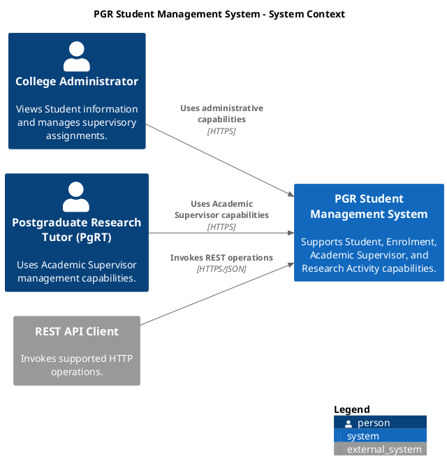
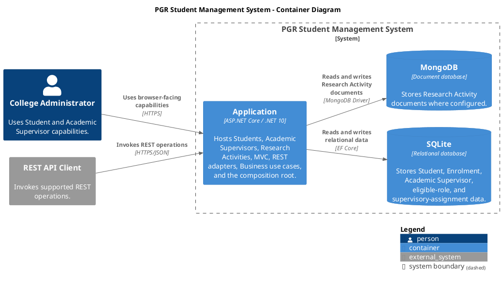
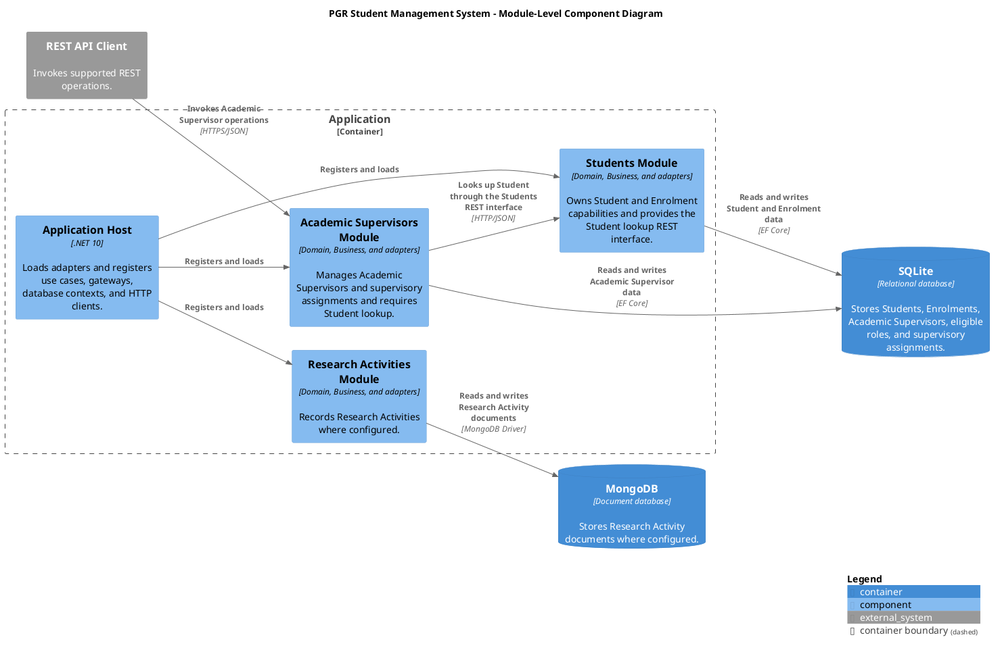

# Week 7 Laboratory 2: Reverse Engineering the Service-Oriented Implementation

## Software Architecture and Design

**Duration:** 2 hours  
**Starting point:** The implementation completed in Week 7 Laboratory 1  
**Focus:** Reverse engineer the Students and Academic Supervisors implementation using architectural models and document the service interfaces

## 1. Purpose

In Laboratory 1, you added Academic Supervisors to the Week 6 Clean Architecture and explored two implementations of Student lookup:

1. a direct, in-process call through `IStudentLookup`; and
2. an HTTP interaction through `HttpStudentLookupAdapter` and the Students REST endpoint.

In this laboratory, you will model the implementation you actually produced. You will create complementary views of the system:

- System Context diagram;
- C4 Container diagram;
- C4 Component diagram;
- UML implementation Class diagram;
- UML Sequence diagram for the direct lookup; and
- UML Sequence diagram for the HTTP-based lookup.

You will also document the REST interfaces of Students and Academic Supervisors using OpenAPI.

The diagrams must describe the implementation truthfully. Do not model Students and Academic Supervisors as separate deployable containers unless they run as separate applications or processes.

## 2. Required Outputs

By the end of the laboratory, retain the following artefacts in a `docs/week07` directory or another clearly named documentation directory:

```text
docs/week07/
├── system-context.puml
├── system-context.png
├── container-diagram.puml
├── container-diagram.png
├── component-diagram.puml
├── component-diagram.png
├── implementation-class-diagram.puml
├── implementation-class-diagram.png
├── direct-lookup-sequence.puml
├── direct-lookup-sequence.png
├── http-lookup-sequence.puml
├── http-lookup-sequence.png
├── openapi.json
├── openapi-notes.md
└── architecture-reflection.md
```

You may use Mermaid or another modelling tool if agreed with your tutor, but the examples in these instructions use PlantUML and C4-PlantUML.

Your final submission should include both the editable diagram source and a rendered PNG image for every diagram.

## 3. Modelling Rules

Apply the following rules throughout the laboratory:

- Model the implementation you built, not an imagined target architecture.
- Keep each diagram at one abstraction level.
- Use the same names for modules, ports, use cases, adapters, endpoints, and models across all diagrams.
- Distinguish compile-time dependency from runtime interaction.
- Distinguish incoming adapters from outgoing adapters.
- Represent `IStudentLookup` as an Academic Supervisors Business-owned output port.
- Represent the Students lookup use case as a Students Business input port.
- Show HTTP only where the implementation actually uses HTTP.
- Do not treat every `.csproj`, namespace, class, or folder as a C4 container.
- Do not expose persistence records as service-interface models unless your implementation actually does so.
- Use notes sparingly. Prefer clear names and labelled relationships.

## 4. Preparation: Capture the Implementation

Before drawing the diagrams, record the current implementation.

### Runtime information

Record:

```text
Application URL:
Students lookup route:
Academic Supervisors route:
SQLite database path:
MongoDB configuration, if running:
Number of running application processes:
IStudentLookup runtime implementation:
```

### Code information

Identify the exact names and locations of:

- Academic Supervisors input port;
- Academic Supervisors use case;
- `IStudentLookup`;
- local Student lookup adapter, if retained;
- `HttpStudentLookupAdapter`;
- Students lookup input port;
- Students lookup use case;
- Students REST controller;
- Academic Supervisors REST controller;
- persistence output ports;
- persistence adapters or DAOs;
- API request and response models;
- Application dependency-injection registrations; and
- `StudentManagementDbContext`.

### Verify the implementation

Run the application and test:

1. the Students lookup endpoint directly;
2. the Academic Supervisors operation for a known Student;
3. the Academic Supervisors operation for an unknown Student; and
4. one Academic Supervisor Business-rule failure.

Keep the requests and responses available while modelling.

---

# 5. Required Tasks

## Task 1: Review the System Context Diagram

### Objective

Review the supplied System Context diagram against the requirements and the implementation. Correct it only where the supplied view does not accurately represent the system boundary, actors, or external software.

### Initial diagram

Copy the following source into:

```text
docs/week07/system-context.puml
```



### Review steps

1. Confirm that the PGR Student Management System is the system of interest.
2. Confirm which actors initiate the Students and Academic Supervisors use cases represented by your implementation.
3. Retain the Postgraduate Research Tutor only if the selected Academic Supervisors use case is initiated by that actor in the requirements or implementation.
4. Confirm that the REST API Client is external to the system.
5. Remove any internal modules, projects, classes, databases, ports, or routes accidentally added to this view.
6. Update descriptions where they do not match the implemented capabilities.
7. Render the final diagram as:

```text
docs/week07/system-context.png
```

### Checkpoint

The diagram should answer:

> Who uses the system, and what external relationships exist?

It should not show Students, Academic Supervisors, `IStudentLookup`, controllers, SQLite, or implementation classes.

---

## Task 2: Review the C4 Container Diagram

### Objective

Review the supplied Container diagram against the actual runtime and deployment topology produced in Laboratory 1.

### Expected standard topology

For the standard Laboratory 1 implementation, the expected view contains one ASP.NET Core Application container and the relevant database containers. The HTTP request from Academic Supervisors back to the Students endpoint is an internal HTTP interaction with the same Application container. Show that interaction in the Component and Sequence diagrams rather than inventing a second application container.

### Initial diagram

Copy the following source into:

```text
docs/week07/container-diagram.puml
```



### Review steps

1. Run the solution and count the independently running applications and data stores.
2. Confirm that Students and Academic Supervisors run inside the same Application process for the standard implementation.
3. Confirm the technologies and descriptions used by the Application, SQLite, and MongoDB containers.
4. Remove MongoDB if Research Activities are not part of the running solution being modelled.
5. Confirm that protocols and relationship directions match the implementation.
6. Do not convert `.csproj` projects, modules, controllers, or namespaces directly into containers.
7. If you completed the separate-applications extension, replace the supplied single-Application view with the topology you actually run and record the process and URL evidence.
8. Render the final diagram as:

```text
docs/week07/container-diagram.png
```

### Checkpoint

The diagram should answer:

> What runs or is deployed, and how do those runtime units communicate?

---

## Task 3: Review the C4 Component Diagram

### Objective

Review the supplied module-focused Component diagram against the final Laboratory 1 implementation.

The Component diagram should contain one component for each major module or service-oriented capability. Controllers, ports, use cases, mappers, DAOs, and individual persistence classes belong in the implementation Class and Sequence diagrams, not as additional C4 components.

### Initial diagram

Copy the following source into:

```text
docs/week07/component-diagram.puml
```



### Review steps

1. Confirm that the component names match the terminology used in the implementation and Laboratory 1.
2. Confirm that Students and Academic Supervisors are components inside the Application container boundary.
3. Confirm that the HTTP relationship points from Academic Supervisors to Students.
4. Confirm that Students owns the lookup REST interface.
5. Confirm that Academic Supervisors Business owns `IStudentLookup`, while `HttpStudentLookupAdapter` implements it. Represent this interpretation through concise relationship wording or a short note rather than adding every class as a C4 component.
6. Confirm that Students and Academic Supervisors access the shared SQLite database in the standard implementation.
7. Remove Research Activities and MongoDB if they are outside the scope of the running implementation being modelled.
8. Do not add controller, mapper, use-case, port, DAO, EF record, or response-model components.
9. Render the final diagram as:

```text
docs/week07/component-diagram.png
```

### Checkpoint

The diagram should answer:

> Which modules or service-oriented capabilities provide the main responsibilities, and how do they collaborate?

---

## Task 4: Document the Service Interfaces with OpenAPI

## Objective

Use the generated OpenAPI document to describe the interfaces exposed by Students and Academic Supervisors.

## Required operations

Document at least:

1. the Students lookup operation; and
2. the Academic Supervisors operation that uses Student lookup.

For each operation, record:

```text
Owning capability:
HTTP method:
Route:
Route parameters:
Query parameters:
Request body schema, or `N/A`:
Successful response status:
Successful response schema:
Not-found response:
Validation or conflict responses:
```

## Configure OpenAPI

Before documenting the service interfaces, confirm that the executable Application project generates an OpenAPI document.

### Register OpenAPI

In:

```text
PgrStudentManagement.Application/Program.cs
```

register OpenAPI before building the application:

```csharp
builder.Services.AddOpenApi();
```

After:

```csharp
var app = builder.Build();
```

map the OpenAPI endpoint in the Development environment:

```csharp
if (app.Environment.IsDevelopment())
{
    app.MapOpenApi();
}
```

Keep the existing exception-handler and HSTS configuration for non-Development environments. The OpenAPI mapping can be placed in a separate Development block or combined carefully with the existing environment-specific pipeline.

### Add the package if required

If `AddOpenApi()` or `MapOpenApi()` is unavailable, add the ASP.NET Core OpenAPI package to the executable Application project:

```bash
dotnet add PgrStudentManagement.Application \
    package Microsoft.AspNetCore.OpenApi \
    --version 10.*
```

Restore and rebuild:

```bash
dotnet restore
dotnet build
```

### Run the application

```bash
dotnet run --project PgrStudentManagement.Application
```

Use the actual executable project path if it differs.

The default document is normally mapped at:

```text
/openapi/v1.json
```

Combine this path with the HTTP or HTTPS address displayed by the application. For example:

```text
https://localhost:7001/openapi/v1.json
```

The actual port is controlled by the Application launch profile.

### Save the generated document

Retrieve the document in a browser or save it with `curl`:

```bash
curl --insecure \
    https://localhost:7001/openapi/v1.json \
    --output docs/week07/openapi.json
```

Replace the URL with the address used by your application. The `--insecure` option is suitable only for a local ASP.NET Core development certificate.

Store the generated document as:

```text
docs/week07/openapi.json
```

Do not edit the generated JSON manually. If it is incorrect, update the controller routes, API models, response declarations, or endpoint configuration and generate it again.

### Add explicit response metadata where required

Generating `openapi.json` does not guarantee that every response returned by a controller is documented. If a generated operation omits an implemented response, add explicit response metadata to the controller action.

For example, the Students lookup operation may use:

```csharp
[ProducesResponseType<StudentLookupResponse>(
    StatusCodes.Status200OK)]
[ProducesResponseType(
    StatusCodes.Status404NotFound)]
```

For the Academic Supervisors operation, document the success, not-found, conflict, and validation responses that the controller can actually return. Do not document outcomes that are not implemented.

After changing response metadata:

1. rebuild the Application project;
2. rerun the application;
3. regenerate `docs/week07/openapi.json`; and
4. confirm that the documented responses match the observed REST-client behaviour.

## Inspect the OpenAPI document

Open `docs/week07/openapi.json` and locate the Students lookup and Academic Supervisors operations.

## Consistency check

Compare OpenAPI with:

- controller route attributes;
- API request and response classes;
- actual REST-client requests and responses; and
- the Component and Sequence diagrams.

Correct any mismatch in:

- route names;
- parameter names;
- JSON field names;
- status codes;
- response schemas; or
- operation ownership.

## Add operation notes

In `openapi-notes.md`, explain:

- why the Students response contains only the information required by the consumer;
- why the HTTP contract is different from `IStudentLookup`;
- how `404 Not Found` is translated by `HttpStudentLookupAdapter`; and
- how other service failures differ from an unknown Student.

---

## Task 5: Create the Implementation Class Diagram

## Objective

Model the implementation classes involved in the cross-module HTTP interaction.

## Scope

Include only classes and interfaces required to explain the selected flow. Do not include every class in the solution.

## Required Academic Supervisors elements

Include the actual equivalents of:

- Academic Supervisors REST controller;
- API request and response models;
- API mapper;
- Academic Supervisors input port;
- Academic Supervisors use case;
- Business input DTO and result or outcome;
- `IStudentLookup` output port;
- `HttpStudentLookupAdapter`;
- adapter-owned Student lookup response model;
- Academic Supervisor persistence output ports;
- Academic Supervisor persistence implementation; and
- `AcademicSupervisor`, `SupervisoryAssignment`, and related enums.

## Required Students elements

Include the actual equivalents of:

- Students REST controller;
- Student lookup API response;
- Students API mapper;
- Students lookup input port;
- Students lookup use case;
- Student persistence output port;
- Student persistence implementation; and
- `Student` or `StudentSummary` models where relevant.

## Required relationships

Show:

- interface implementation;
- constructor dependency;
- DTO composition;
- mapper dependencies;
- controller-to-input-port dependency;
- use-case-to-output-port dependency;
- HTTP-adapter implementation of `IStudentLookup`; and
- persistence-adapter implementation of persistence ports.

## Model separation

Use stereotypes or package boundaries to distinguish:

```text
<<domain entity>>
<<input port>>
<<output port>>
<<use case>>
<<incoming adapter>>
<<outgoing adapter>>
<<API request>>
<<API response>>
<<persistence adapter>>
<<composition root>>
```

If the implementation currently uses the same class for multiple purposes, model it truthfully and record the coupling in the reflection rather than inventing separate models.

## Checkpoint

The diagram should answer:

> Which implementation structures realise the service-oriented design and dependency direction?

---

## Task 6: Review the Direct-Call Sequence Diagram

## Objective

Validate and refine the direct-call sequence diagram created in Laboratory 1.

## Required participants

Use the actual implementation names for:

- REST API Client;
- Academic Supervisors REST controller;
- Academic Supervisors input port;
- Academic Supervisors use case;
- `IStudentLookup`;
- local Student lookup implementation or adapter;
- Students persistence port;
- Students persistence adapter;
- `StudentManagementDbContext`; and
- SQLite.

## Required alternatives

Show:

- Student found; and
- Student not found.

Add other Academic Supervisor Business outcomes only where they help explain the selected flow.

## Required distinction

Label the call through `IStudentLookup` as an in-process call. Do not show HTTP between Academic Supervisors and Students in this diagram.

## Checkpoint

Verify that the direct-call participants and names match the Class and Component diagrams.

---

## Task 7: Create the HTTP-Based Sequence Diagram

## Objective

Model the final runtime interaction across the Students REST boundary.

## Required participants

Include the actual equivalents of:

- REST API Client;
- Academic Supervisors REST controller;
- Academic Supervisors API mapper;
- Academic Supervisors input port;
- Academic Supervisors use case;
- `IStudentLookup`;
- `HttpStudentLookupAdapter`;
- Students REST controller;
- Students API mapper;
- Students lookup input port;
- Students lookup use case;
- Students persistence output port;
- Students persistence adapter;
- `StudentManagementDbContext`; and
- SQLite.

## Required successful flow

Show:

```text
REST client
    -> Academic Supervisors endpoint
        -> Academic Supervisors use case
            -> IStudentLookup
                -> HttpStudentLookupAdapter
                    -> HTTP GET Students lookup endpoint
                        -> Students use case
                            -> Students persistence
                                -> SQLite
                    <- 200 OK with Student response
                <- StudentSummary
            -> continue Academic Supervisor rules and persistence
    <- Academic Supervisors HTTP response
```

## Required alternatives

Include at least:

1. **Student found**: Students returns `200 OK`; the adapter maps the response to `StudentSummary`.
2. **Student not found**: Students returns `404 Not Found`; the adapter returns the existing not-found result; Academic Supervisors returns its documented outcome.
3. **Students endpoint failure**: the endpoint is unavailable, times out, or returns another unsuccessful response. Show that this is not treated as Student not found.

## Boundary labels

Clearly identify:

- local method calls;
- interface dispatch;
- the HTTP request and response; and
- database interaction.

## Checkpoint

The sequence should agree with:

- the REST routes in OpenAPI;
- the API model names in the Class diagram;
- the components in the Component diagram; and
- the actual dependency-injection configuration.

---

# 6. Required Completion Criteria

## Architecture models

- [ ] System Context diagram identifies people, external software, and the system boundary.
- [ ] Container diagram reflects the actual runtime topology.
- [ ] Component diagram shows Students, Academic Supervisors, their adapters, and persistence responsibilities.
- [ ] Implementation Class diagram uses actual classes and interfaces.
- [ ] Direct-call Sequence diagram shows the local `IStudentLookup` interaction.
- [ ] HTTP Sequence diagram shows the Students REST interaction.
- [ ] All diagrams retain editable source files.
- [ ] Every diagram has a rendered PNG image in `docs/week07`.

## Service-interface documentation

- [ ] OpenAPI generation is configured in the Application project.
- [ ] The generated document is saved as `docs/week07/openapi.json`.
- [ ] Students lookup operation is documented from OpenAPI.
- [ ] Academic Supervisors operation is documented from OpenAPI.
- [ ] Routes, methods, parameters, response models, and status codes match the implementation.
- [ ] `openapi-notes.md` distinguishes the HTTP contract from `IStudentLookup`.

## Consistency

- [ ] Students and Academic Supervisors names are consistent across diagrams.
- [ ] `IStudentLookup` is represented as an Academic Supervisors output port.
- [ ] The Students lookup use case is represented as a Students input port.
- [ ] The HTTP adapter is represented as an outgoing adapter.
- [ ] Container boundaries match the running processes.
- [ ] Shared database access is shown accurately.
- [ ] The HTTP Sequence diagram includes Student-not-found and endpoint-failure alternatives.

---

# 7. Extension Tasks

Complete extension tasks only after all required diagrams and consistency checks are finished.

## Extension 1: Generate a Client from OpenAPI

Generate a typed client for the Students API from the OpenAPI document.

Possible tools include:

- NSwag;
- Kiota; or
- OpenAPI Generator.

Replace the hand-written HTTP details inside the outgoing adapter with the generated client, but keep the generated client behind `IStudentLookup`.

Compare:

- hand-written and generated client code;
- response-model ownership;
- error handling;
- regeneration workflow; and
- coupling to the OpenAPI contract.

Update the Class and Sequence diagrams if implementation classes change.

## Extension 2: Separate the Academic Supervisors Database

Move Academic Supervisors persistence away from the Students `StudentManagementDbContext` and shared relational database.

Consider:

- a separate `AcademicSupervisorManagementDbContext`;
- separate migrations;
- a separate SQLite database or another relational database;
- removal of database foreign keys across service boundaries;
- retaining Student identity as a contract value; and
- data consistency when Student data changes.

Update the Container, Component, Class, and Sequence diagrams to reflect the new persistence boundary.

## Extension 3: Run Students and Academic Supervisors as Separate Applications

Create separate executable hosts and run the modules independently.

The result should have:

- a Students application with its own listening address;
- an Academic Supervisors application with its own listening address;
- Students API configuration in the Academic Supervisors host;
- independent startup and shutdown; and
- an HTTP interaction between two processes.

Update the C4 Container diagram. Only at this point should Students and Academic Supervisors be shown as separate application or service containers.

Record the commands, URLs, and process evidence used to validate the topology.

## Extension 4: Expose Additional Students Capabilities

Expose another existing Students use case through the Students REST interface, such as viewing Student Enrolments.

Add:

- the Students Business input port or use case;
- API request or response models;
- controller operation;
- OpenAPI documentation;
- REST-client verification; and
- updates to the Component, Class, and Sequence diagrams where relevant.

Consider whether the new operation is cohesive with the existing Students service boundary.

---

# 8. Final Review and Commit

Before finishing:

1. render every diagram;
2. check labels and arrow directions;
3. regenerate `docs/week07/openapi.json` and compare routes with it;
4. compare class names with the implementation;
5. confirm the Container diagram matches the running topology;
6. verify both Sequence diagrams; and
7. complete `architecture-reflection.md`.

Commit the documentation:

```bash
git status
git add docs/week07
git commit -m "Add Week 7 service architecture models"
```

Retain the rendered diagrams, source diagrams, OpenAPI notes, and reflection for the debrief lecture.
